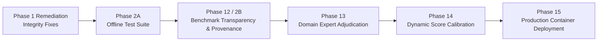

# Tender Saathi — Project Roadmap

**Active Milestone**: Milestone: Benchmark Transparency, Ground-Truth Quality, and Source Provenance (Phase 12)  
**Baseline Test Status**: 516 backend passed (100% offline), 4 frontend passed, frontend build clean.

---

## Roadmap Overview

---

## Phase Breakdown

### Completed Foundations
- [x] **Phase 01–04**: Retrieval & Catalogue Foundations (SQLite BIS catalogue, BM25, MiniLM embeddings).
- [x] **Phase 05**: Human Review & Decision Audit Trail (`ACCEPT`, `EDIT`, `DISMISS`, report regeneration).
- [x] **Phase 06**: Adversarial Evaluation & Robustness (Distractor token rejection, negative controls).
- [x] **Phase 07**: Multilingual Technical Normalization (Hinglish/Indic transliteration and lexicon mapping).
- [x] **Phase 08**: Decision Safety & Operational Envelopes (10-stage decision safety pipeline).
- [x] **Phase 09**: Standards Relationships & Regulatory Mapping (QCO, CRS, Hallmarking intelligence).
- [x] **Phase 10**: Documentation & Developer Experience (Comprehensive architecture guides).
- [x] **Phase 11**: Production Deployment Architecture (Decoupled Vercel frontend + Container backend).
- [x] **Phase 1 Remediation**: Recommendation Integrity (AUDIT-01 parent rollup, AUDIT-02 UI filtering, AUDIT-04 `ReviewStatus` enum).
- [x] **Phase 2A**: Deterministic Offline Testing (Conftest network guard, HuggingFace offline mode, deterministic fixtures for `test_05` and `test_05b`).

---

### Active Phase: Phase 12 — Benchmark Transparency, Ground-Truth Quality & Source Provenance

**Goal**: Transform the initial 20-row prototype evaluation into an enterprise-grade, auditable evaluation harness that binds each benchmark case to its source procurement tender, measures multi-dimensional performance (ranking, abstention, evidence grounding, sector coverage), and creates an airtight workflow for expert adjudication without data contamination.

- [ ] **12-01**: Ground-Truth Schema & Provenance Audit (Extend schema with non-breaking provenance/reviewer columns, audit 20 baseline rows, document evidence links).
- [ ] **12-02**: Multi-Metric Reproducible Evaluation Harness (De-conflate abstention from accuracy, add Precision@Coverage, Evidence Grounding Score, and Sector Stratification).
- [ ] **12-03**: Ground-Truth Expansion & Review Gating (Ingest real tender candidates from `tenders/raw/`, enforce strict separation between `MACHINE_PREDICTED` and `EXPERT_VERIFIED`, build validation gate preventing false `human_verified` claims).

---

### Upcoming Phases
- [ ] **Phase 13**: Domain Expert Adjudication (Engage CPWD/BIS procurement experts to formally sign off on ground-truth benchmark cases).
- [ ] **Phase 14**: Calibrated Ambiguity & Successor Tuning (ROC/precision-recall calibration of `AUDIT-05` separation margin and evaluation of `AUDIT-03` successor initial scoring).
- [ ] **Phase 15**: Production Containerized Deployment (Final container packaging, environment secrets auditing, and health monitoring).
