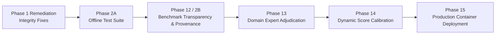

# Tender Saathi — Project Roadmap

**Active Milestone**: Milestone: Benchmark Transparency, Ground-Truth Quality, and Source Provenance (Phase 12)  
**Baseline Test Status**: 516 backend passed (100% offline), 4 frontend passed, frontend build clean.

---

## Roadmap Overview

---

## Phase Breakdown

### Completed Foundations
- [x] **Phase 01–04**: Retrieval & Catalogue Foundations (SQLite BIS catalogue, BM25, MiniLM embeddings).
- [x] **Phase 05**: Human Review & Decision Audit Trail (`ACCEPT`, `EDIT`, `DISMISS`, report regeneration).
- [x] **Phase 06**: Adversarial Evaluation & Robustness (Distractor token rejection, negative controls).
- [x] **Phase 07**: Multilingual Technical Normalization (Hinglish/Indic transliteration and lexicon mapping).
- [x] **Phase 08**: Decision Safety & Operational Envelopes (10-stage decision safety pipeline).
- [x] **Phase 09**: Standards Relationships & Regulatory Mapping (QCO, CRS, Hallmarking intelligence).
- [x] **Phase 10**: Documentation & Developer Experience (Comprehensive architecture guides).
- [x] **Phase 11**: Production Deployment Architecture (Decoupled Vercel frontend + Container backend).
- [x] **Phase 1 Remediation**: Recommendation Integrity (AUDIT-01 parent rollup, AUDIT-02 UI filtering, AUDIT-04 `ReviewStatus` enum).
- [x] **Phase 2A**: Deterministic Offline Testing (Conftest network guard, HuggingFace offline mode, deterministic fixtures for `test_05` and `test_05b`).

---

### Completed Foundations & Benchmark Transparency
- [x] **Phase 01–04**: Retrieval & Catalogue Foundations (SQLite BIS catalogue, BM25, MiniLM embeddings).
- [x] **Phase 05**: Human Review & Decision Audit Trail (`ACCEPT`, `EDIT`, `DISMISS`, report regeneration).
- [x] **Phase 06**: Adversarial Evaluation & Robustness (Distractor token rejection, negative controls).
- [x] **Phase 07**: Multilingual Technical Normalization (Hinglish/Indic transliteration and lexicon mapping).
- [x] **Phase 08**: Decision Safety & Operational Envelopes (10-stage decision safety pipeline).
- [x] **Phase 09**: Standards Relationships & Regulatory Mapping (QCO, CRS, Hallmarking intelligence).
- [x] **Phase 10**: Documentation & Developer Experience (Comprehensive architecture guides).
- [x] **Phase 11**: Production Deployment Architecture (Decoupled Vercel frontend + Container backend).
- [x] **Phase 1 Remediation**: Recommendation Integrity (AUDIT-01 parent rollup, AUDIT-02 UI filtering, AUDIT-04 `ReviewStatus` enum).
- [x] **Phase 2A**: Deterministic Offline Testing (Conftest network guard, HuggingFace offline mode, deterministic fixtures for `test_05` and `test_05b`).
- [x] **Phase 12**: Benchmark Transparency, Ground-Truth Quality & Source Provenance (Schema extended to 24 columns, 20/20 physical PDF provenance, decoupled evaluation harness, CI governance gate).

---

### Active Phase: Phase 13 — Expert Ground-Truth Adjudication & Evaluation Calibration

**Goal**: Establish a defensible, auditable adjudication workflow for Tender Saathi's benchmark, generate reviewer-ready case packets for 40 procurement cases, implement a two-party consensus and governance validation tool, and define the formal stopping boundary for qualified domain experts.

- [ ] **13-01**: Reviewer Case Packet Generator & Adjudication Rubric Specification (Canonical rubric `ADJUDICATION_RUBRIC.md`, automated packet compiler, 40 structured case packets).
- [ ] **13-02**: Adjudication Ingestion, Two-Party Consensus Tool & Governance Enforcer (`scripts/ingest_adjudication.py`, qualification gate enforcement, conflict escalation).
- [ ] **13-03**: Expert Verification Boundary, Packet Delivery & Milestone Readiness (Unit testing, full suite regression, evaluation stratification, Expert Handoff Dossier).

---

### Upcoming Phases
- [ ] **Phase 14**: Calibrated Ambiguity & Threshold Calibration (ROC/precision-recall calibration of `AUDIT-05` separation margin and evaluation of `AUDIT-03` successor initial scoring).
- [ ] **Phase 15**: Production Containerized Deployment (Final container packaging, environment secrets auditing, and health monitoring).
