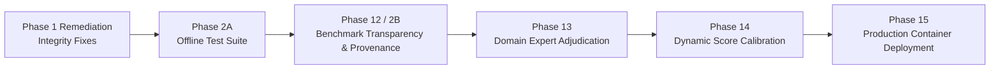

# Tender Saathi — Project Roadmap

**Active Milestone**: Milestone: Benchmark Transparency, Ground-Truth Quality, and Source Provenance (Phase 12)  
**Baseline Test Status**: 516 backend passed (100% offline), 4 frontend passed, frontend build clean.

---

## Roadmap Overview

---

## Phase Breakdown

### Completed Foundations
- [x] **Phase 01–04**: Retrieval & Catalogue Foundations (SQLite BIS catalogue, BM25, MiniLM embeddings).
- [x] **Phase 05**: Human Review & Decision Audit Trail (`ACCEPT`, `EDIT`, `DISMISS`, report regeneration).
- [x] **Phase 06**: Adversarial Evaluation & Robustness (Distractor token rejection, negative controls).
- [x] **Phase 07**: Multilingual Technical Normalization (Hinglish/Indic transliteration and lexicon mapping).
- [x] **Phase 08**: Decision Safety & Operational Envelopes (10-stage decision safety pipeline).
- [x] **Phase 09**: Standards Relationships & Regulatory Mapping (QCO, CRS, Hallmarking intelligence).
- [x] **Phase 10**: Documentation & Developer Experience (Comprehensive architecture guides).
- [x] **Phase 11**: Production Deployment Architecture (Decoupled Vercel frontend + Container backend).
- [x] **Phase 1 Remediation**: Recommendation Integrity (AUDIT-01 parent rollup, AUDIT-02 UI filtering, AUDIT-04 `ReviewStatus` enum).
- [x] **Phase 2A**: Deterministic Offline Testing (Conftest network guard, HuggingFace offline mode, deterministic fixtures for `test_05` and `test_05b`).

---

### Completed Foundations & Benchmark Transparency
- [x] **Phase 01–04**: Retrieval & Catalogue Foundations (SQLite BIS catalogue, BM25, MiniLM embeddings).
- [x] **Phase 05**: Human Review & Decision Audit Trail (`ACCEPT`, `EDIT`, `DISMISS`, report regeneration).
- [x] **Phase 06**: Adversarial Evaluation & Robustness (Distractor token rejection, negative controls).
- [x] **Phase 07**: Multilingual Technical Normalization (Hinglish/Indic transliteration and lexicon mapping).
- [x] **Phase 08**: Decision Safety & Operational Envelopes (10-stage decision safety pipeline).
- [x] **Phase 09**: Standards Relationships & Regulatory Mapping (QCO, CRS, Hallmarking intelligence).
- [x] **Phase 10**: Documentation & Developer Experience (Comprehensive architecture guides).
- [x] **Phase 11**: Production Deployment Architecture (Decoupled Vercel frontend + Container backend).
- [x] **Phase 1 Remediation**: Recommendation Integrity (AUDIT-01 parent rollup, AUDIT-02 UI filtering, AUDIT-04 `ReviewStatus` enum).
- [x] **Phase 2A**: Deterministic Offline Testing (Conftest network guard, HuggingFace offline mode, deterministic fixtures for `test_05` and `test_05b`).
- [x] **Phase 12**: Benchmark Transparency, Ground-Truth Quality & Source Provenance (Schema extended to 24 columns, 20/20 physical PDF provenance, decoupled evaluation harness, CI governance gate).

---

### Normative Standards Ingestion, Evidence Integration & Support Engine Verification
- [x] **Phase 13**: Domain Expert Adjudication & Evaluation Calibration (`reports/adjudication_packets/packets/`, consensus tool).
- [x] **Phase 14**: Calibration Readiness & Protocol Design (`docs/evaluation/PHASE14_CALIBRATION_READINESS.md`).
- [x] **Phase 15**: Real-World Evaluation Corpus Readiness (`docs/evaluation/PHASE15_CORPUS_READINESS.md`).
- [x] **Phase 16**: Evidence Traceability & Recommendation Verification (`docs/evaluation/PHASE16_EVIDENCE_TRACEABILITY_AUDIT.md`).
- [x] **Phase 17**: Evidence Integrity & Verification Semantics Audit (`docs/evaluation/PHASE17_EVIDENCE_INTEGRITY_AUDIT.md`).
- [x] **Phase 18**: Controlled Normative Standards Corpus Ingestion (`src/corpus/`, PDF extraction, edition isolation).
- [x] **Phase 19**: Safe Clause-Level Evidence Integration (`src/corpus/retriever.py`, grounded passage retrieval).
- [x] **Phase 20**: Evidence-to-Requirement Validation Audit (`RequirementEvidenceSupportState`, 12 adversarial tests).
- [x] **Phase 21**: Evidence Support Engine Validation Audit (Conservative parameters, unit conversions, inequality directions, tolerance, negation, multi-passage conflict detection, 18-case adversarial matrix).
- [x] **Phase 22**: Multi-Requirement Conflict Resolution & Standards Precedence Engine (`CrossRequirementConflictEngine`, 7 conflict categories, tender audit integration, post-implementation safety audit, 15 adversarial regression tests).

---

### Multi-Package Tender Auditing, Catalogue Integration & Demonstration Hardening
- [x] **Phase 23**: Production Containerized Deployment & Cloud Run Hardening.
- [x] **Phase 24–33**: National BIS Catalogue Ingestion, FTS5 Search Indexing, Multi-Package Tender Ingestion & Audit Pipeline.
- [x] **Phase 34**: Production Readiness & Coverage Audit (`docs/evaluation/PHASE34_PRODUCTION_READINESS_AUDIT.md`).
- [x] **Phase 35**: Demonstration Readiness, Negative-Control Evaluation & Catalogue Hygiene (`docs/evaluation/PHASE35_DEMONSTRATION_READINESS_REPORT.md`).
- [x] **Phase 36**: Final End-to-End Recommendation Audit & SIH Demo Hardening (`docs/evaluation/PHASE36_FINAL_E2E_AUDIT.md`).

---

### Upcoming Phases
- [ ] **Phase 37**: Hackathon Pitch Deck, Live Demo Script & Deployment Packaging (5-minute SIH live demonstration script, judges FAQ, and turnkey Docker Compose packaging).

