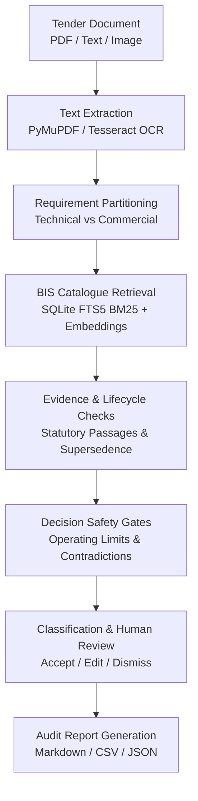

<div align="center">

# Tender Saathi

### **Find the right Indian Standard for a tender, with supporting evidence.**

An open-source, evidence-backed decision-support system for technical tender specification auditing against Bureau of Indian Standards (BIS) codes.

<p>
  <a href="https://tendersaathi.vercel.app/"><strong>Try Live Demo</strong></a> •
  <a href="https://github.com/syed-imadulla/Tender-saathi"><strong>GitHub Repository</strong></a> •
  <a href="docs/demo/SIH_LIVE_DEMO.md"><strong>5-Minute Demo Script</strong></a> •
  <a href="docs/demo/JUDGE_QA.md"><strong>Judge Q&A Guide</strong></a>
</p>

<p>
  <a href="https://tendersaathi.vercel.app/"></a>
  <a href="https://github.com/syed-imadulla/Tender-saathi"></a>
</p>

<p>
  
  
  
  
  
  
</p>

<p>
  Tender Saathi extracts technical requirements from tender documents, matches them across 35,208 BIS standards using lexical and semantic search, verifies authentic statutory clauses, and routes uncertain cases to an interactive human review queue.
</p>

</div>

---

## Table of Contents

1. [The Problem in Public Procurement](#the-problem-in-public-procurement)
2. [What Tender Saathi Does](#what-tender-saathi-does)
3. [Why Not Just Use a Normal AI Chatbot?](#why-not-just-use-a-normal-ai-chatbot)
4. [See It in Action (3 Demo Scenarios)](#see-it-in-action-3-demo-scenarios)
5. [How It Works (System Architecture)](#how-it-works-system-architecture)
6. [How Recommendations Are Classified](#how-recommendations-are-classified)
7. [BIS Data Coverage & Database Boundaries](#bis-data-coverage-database-boundaries)
8. [Key Capabilities](#key-capabilities)
9. [Software Tests and Evaluation Disclosure](#software-tests-and-evaluation-disclosure)
10. [Technology Stack](#technology-stack)
11. [Quick Start: Docker & Local Setup](#quick-start-docker-local-setup)
12. [API Reference Overview](#api-reference-overview)
13. [Current Limitations and Next Steps](#current-limitations-and-next-steps)
14. [Documentation Sitemap](#documentation-sitemap)
15. [Disclaimer and Attribution](#disclaimer-and-attribution)

---

## The Problem in Public Procurement

Government departments and public sector undertakings in India publish thousands of technical tenders every month on platforms like GeM, CPPP, and state procurement portals. A single infrastructure, water supply, or electrical tender often contains dozens of distinct technical requirements mixed with procurement boilerplate.

When drafting or reviewing tender specifications, procurement officers must reference the correct Indian Standards (BIS codes). To do this accurately, they need to verify:
- Whether the standard genuinely covers the specific material, diameter, pressure class, and temperature conditions.
- Whether the standard is currently active, superseded by a newer edition, or withdrawn.
- Which companion standards are mandatory (e.g., test methods, sampling procedures, and installation practices).
- The exact clause text that supports the recommendation.

**Finding a possible standard number is easy. Proving that it fits the tender, is active, and is backed by real evidence is the hard part.**

| Common Procurement Challenge | How Tender Saathi Handles It |
| :--- | :--- |
| **Citing Withdrawn or Superseded Standards**<br/>Officers may inadvertently cite older editions that have been replaced by newer BIS codes. | Tracks recorded lifecycle status across the catalogue and flags withdrawn or superseded standards with clear warnings. |
| **Technical Specs Mixed with Commercial Boilerplate**<br/>Tender documents blend technical requirements with EMD, payment terms, and turnover criteria. | Automatically separates commercial terms from engineering specifications; safely excludes commercial terms from standards matching. |
| **Missing or Incomplete Specifications**<br/>A tender clause might ask for "pipes" without mentioning diameter, pressure, or temperature. | Detects missing engineering parameters and flags the requirement for clarification instead of making an ungrounded guess. |
| **Hallucinated or Unsupported Standards**<br/>Generic AI tools frequently invent plausible-sounding standard numbers and non-existent clauses. | Grounds every recommendation in an authoritative local BIS catalogue; separates catalogue metadata discovery from verified clause passages. |

---

## What Tender Saathi Does

Tender Saathi provides an evidence-backed decision-support system designed for the procurement officer's workflow:

1. **Ingest Tender**: Upload a tender PDF, upload an image of a tender notice, or paste raw text.
2. **Extract & Partition**: The system extracts clean digital text and separates procurement terms (EMD, bank guarantees, delivery periods) from technical specifications.
3. **Catalogue Search**: It queries 23,510 active BIS catalogue records using fast lexical search (SQLite FTS5 BM25) and dense semantic embeddings.
4. **Evidence Grounding**: It checks whether candidate standards belong to our indexed statutory gazette corpus (`corpus.db`). If present, it retrieves verbatim clause passages.
5. **Enforce Safety Gates**: It verifies operating conditions (pressure, temperature, medium) and checks whether the standard is active or superseded.
6. **Classify Transparency**: It tags results with clear evidence tiers (`CLAUSE_VERIFIED`, `CATALOGUE_DISCOVERED`, or `SAFE_ABSTENTION`).
7. **Officer Review & Report**: The officer can review, accept, edit, or dismiss recommendations with notes, then export clean Markdown, JSON, or CSV audit reports.

---

## Why Not Just Use a Normal AI Chatbot?

Generic AI chatbots rely on training data memory, which frequently leads to outdated citations and invented clauses. Tender Saathi is built on deterministic software rules and local authoritative databases:

| Feature / Dimension | Generic AI Chatbot | Tender Saathi |
| :--- | :--- | :--- |
| **Standards Data Source** | Parametric memory (unverifiable, often outdated) | Authoritative local SQLite database of **35,208 BIS records** |
| **Supporting Evidence** | Generates plausible clause text from memory | Cites verbatim passages from verified statutory gazette documents |
| **Lifecycle Validity** | Unaware of whether an edition is currently valid | Tracks active, superseded, and withdrawn statuses across records |
| **Commercial Clauses** | Tries to force a technical standard on financial clauses | Recognizes EMD / guarantees and safely abstains (`candidate_standard=None`) |
| **Incomplete Specifications** | Silently guesses missing pressure or material parameters | Flags missing parameters and routes the clause to human review |
| **Audit Trail & Provenance** | Transient chat response with no verifiable receipts | Exportable Markdown, CSV, and JSON audit reports with reviewer notes |
| **Offline Reliability** | Requires continuous cloud connectivity and paid API calls | Runs 100% offline using local SQLite indexes and local embeddings |

---

## See It in Action (3 Demo Scenarios)

Try the live web application:  
🔗 **[https://tendersaathi.vercel.app/](https://tendersaathi.vercel.app/)**

You can test these representative scenarios directly in the web UI:

### Scenario 1: Supported Technical Requirement (CPVC Pipe)
- **Input Text**:
  > *"Providing and fixing Chlorinated Polyvinyl Chloride (CPVC) pipes for potable hot and cold water supplies, SDR 11, working pressure 1.0 MPa at 82 deg C."*
- **Expected System Action**: Identifies **IS 15778 : 2007** (Active).
- **Evidence / Status**: Tagged as **`CLAUSE_VERIFIED`** (Green badge). Displays verbatim gazette clauses (Clause 4.1 material requirements, Clause 6.2 dimensions) and links companion solvent cement standard **IS 14182**.
- **What It Demonstrates**: Full-text statutory clause grounding for supported civil engineering standards.

### Scenario 2: Mixed Tender (Technical Scope + Commercial Boilerplate)
- **Input Text**:
  > *"Item 1: PVC insulated unsheathed copper conductor cables for electrical wiring conforming to IS 694.\nItem 2: EMD amount of INR 1,50,000 shall be submitted online. Performance security of 10% valid for 12 months."*
- **Expected System Action**: Partitions the document into separate requirements.
- **Evidence / Status**:
  - Item 1 maps to **IS 694 : 2010** (`CLAUSE_VERIFIED`).
  - Item 2 is classified as procurement boilerplate and excluded from standards matching (`candidate_standard=None`, `SAFE_ABSTENTION`).
- **What It Demonstrates**: Safe abstention on commercial clauses without hallucinating standards.

### Scenario 3: Catalogue-Only Discovery (Human Review Required)
- **Input Text**:
  > *"Self-contained open-circuit compressed air breathing apparatus for industrial rescue operations."*
- **Expected System Action**: Matches catalogue metadata to **IS 10245 (Part 2) : 1996**.
- **Evidence / Status**: Tagged as **`CATALOGUE_DISCOVERED`** (Amber badge). Shows an explicit notice that full gazette clause text is not yet indexed, and flags `human_review_required=True`.
- **What It Demonstrates**: Transparent distinction between catalogue metadata search and authentic clause verification.

### SIH Presentation Resources
- 📖 **[5-Minute Live Presentation Script](docs/demo/SIH_LIVE_DEMO.md)**: Timed click-by-click instructions with contingency fallback protocols.
- 📖 **[Judge Technical Q&A Guide](docs/demo/JUDGE_QA.md)**: Technical answers addressing architecture, safety gates, and scaling.

---

## How It Works (System Architecture)



### Stage-by-Stage Breakdown

1. **Text Extraction**: PyMuPDF extracts clean text from digital PDFs; Tesseract OCR handles scanned images and document photos.
2. **Requirement Partitioning**: Strips procurement boilerplate so retrieval focuses strictly on engineering requirements.
3. **Catalogue Retrieval**: Searches 23,510 active catalogue records using SQLite FTS5 BM25 keyword matching and dense embeddings.
4. **Evidence Checks**: Cross-references candidate standards against the statutory gazette database (`corpus.db`) to find verbatim passages.
5. **Decision Safety Gates**: Validates operating limits (pressure, temperature, medium) and checks whether the standard is active or superseded.
6. **Classification & Human Review**: Tags the result with an evidence tier and records officer review decisions (`ACCEPT`, `EDIT`, `DISMISS`).
7. **Audit Report Generation**: Exports complete audit documentation in Markdown, JSON, and injection-sanitized CSV formats.

---

## How Recommendations Are Classified

Tender Saathi uses three clear result tiers to communicate its level of evidence:

| Decision Outcome | What It Means | Available Evidence | Next Step for Officer |
| :--- | :--- | :--- | :--- |
| **`CLAUSE_VERIFIED`** | Supporting clause text exists in our indexed statutory gazette corpus. | Verbatim clause passage, edition year, and companion standards. | Review the excerpted clause passage and confirm that it fits the tender scope. |
| **`CATALOGUE_DISCOVERED`** | A possible standard was identified through BIS catalogue metadata, but full-text clause evidence is not indexed. | Catalogue metadata title, standard number, and recorded status. | Human review is required. Inspect the official standard document before purchasing. |
| **`SAFE_ABSTENTION`** / **Review Required** | Evidence is insufficient, or the clause is purely commercial, ambiguous, or physically incompatible. | None (safe rejection) or parameter mismatch warning. | Clarify the engineering requirements or seek review from a subject expert. |

> **Statutory Disclaimer**: These labels describe the system's verified data coverage. They provide decision support and do not constitute legal or statutory certification.

---

## BIS Data Coverage & Database Boundaries

We verify database counts directly against the SQLite database files:

| Database File | Key Table | Records | Coverage Details |
| :--- | :--- | :--- | :--- |
| **`data/catalogue/bis_catalogue.db`** | `standards` | **35,208** | Full BIS catalogue snapshot: **10,828** Active, **13,024** Unknown status, **11,340** Withdrawn, and **16** Superseded. |
| **`data/catalogue/catalogue_search_index.db`** | `catalogue_fts` | **23,510** | FTS5 BM25 search index containing all active and unwithdrawn catalogue records. |
| **`data/standards/corpus.db`** | `corpus_passages` | **53 passages** | Authentic statutory gazette passages covering **13 foundational standards** (`CLAUSE_VERIFIED` baseline). |
| **`data/standards/standards.db`** | `standards` | **99 standards** | Curated core standards with **197 verified relationship links** (companion codes, test methods, installation guides). |

**Clear Distinction**: Catalogue metadata coverage (35,208 records) is much broader than authentic clause-level evidence coverage (13 standards, 53 passages). The system never claims that unindexed catalogue records have verified clause text.

---

## Key Capabilities

- **Document Ingestion**: Extracts digital PDFs via PyMuPDF without OCR loss, with Tesseract OCR fallback for scanned images.
- **Requirement Partitioning**: Automatically separates procurement boilerplate from technical engineering clauses.
- **BIS Catalogue Search**: Instant BM25 lexical search across 23,510 active records via SQLite FTS5.
- **Evidence Grounding**: Verbatim clause citations from registered statutory gazette documents.
- **Standards Knowledge Graph**: Models 8 relationship types (normative references, test methods, installation codes, safety codes) capped at depth-1 to prevent drift.
- **Physical Contradiction Gates**: Rejects physically impossible parameters (e.g. PVC pipes for superheated steam at 220°C).
- **Officer Decision History**: Interactive review modal supporting **Accept**, **Edit**, and **Dismiss** actions with persistent notes.
- **Sanitized Report Exports**: Downloadable audit reports in Markdown, JSON, and CSV (sanitized against spreadsheet formula injection).

---

## Software Tests and Evaluation Disclosure

We separate automated software engineering tests from recommendation accuracy evaluation.

### Software Engineering Test Results

Every test command below passes cleanly:

| Test Scope | Target / Command | Tests | Pass Rate | Status |
| :--- | :--- | :--- | :--- | :--- |
| **Phase 38 Reality Check Suite** | `python3 -m pytest tests/test_phase38_production_reality.py` | 12 | **100% (12/12)** | Passed |
| **Full Backend Test Suite** | `python3 -m pytest tests/` | 819 | **100% (819/819)** | Passed (204s) |
| **Phase 37 Packaging Suite** | `python3 -m pytest tests/test_phase37_demo_packaging.py` | 8 | **100% (8/8)** | Passed |
| **Frontend Component Suite** | `cd frontend && npx vitest run` | 12 | **100% (12/12)** | Passed |
| **Frontend Production Build** | `cd frontend && npm run build` | — | **Success** | Built in 1.86s |
| **Docker Compose Config** | `docker compose config` | — | **Valid** | Exit code 0 |
| **Backend Container Health** | `curl -f http://localhost:5000/api/health` | — | **HTTP 200** | Status OK |

### Recommendation Benchmark Disclosure

- Our evaluation baseline ([`dataset/ground_truth/ground_truth.csv`](dataset/ground_truth/ground_truth.csv)) contains **20 representative tender cases** and **5 negative controls** (SHA-256: `8bcc9bc59b8cc69f418626325238fc9f0be24429950a9f78a736177c086e3cfc`).
- On this small initial set, the system achieves 90% Top-1 retrieval recall and 100% negative control rejection.
- **Honest Disclose**: These ground-truth labels were assembled internally and have **not yet been independently audited by accredited BIS sectional committees**. We do not present this small benchmark as a proven real-world accuracy figure across all procurement domains.

For detailed evaluation methodologies, see:
- 📊 **[Benchmark Evaluation Report](docs/evaluation/benchmark.md)**
- 🛡️ **[Adversarial Robustness Suite](docs/evaluation/adversarial_suite.md)**
- ⚠️ **[System Boundaries & Limitations](docs/evaluation/limitations.md)**
- 📋 **[Phase 38 Production Reality Check Audit](docs/evaluation/PHASE38_PRODUCTION_REALITY_CHECK.md)**

---

## Technology Stack

| Layer | Technologies Used | Purpose |
| :--- | :--- | :--- |
| **Frontend UI** | React 18, TypeScript, Vite, D3.js | Single-page application with interactive standards graph visualization |
| **Backend API** | Python 3.11, Flask, Gunicorn | REST endpoints and analysis orchestration |
| **Search Engine** | SQLite3, FTS5 BM25 | Pure-Python lexical retrieval across 23,510 active records |
| **Semantic Retrieval**| PyTorch (CPU build), Sentence-Transformers | Dense vector similarity for domain-specific terminology |
| **Document Processing**| PyMuPDF (fitz), Tesseract OCR, Poppler | PDF text parsing, table isolation, and scanned image OCR |
| **Testing** | Pytest, Vitest | Automated backend and frontend regression test suites |
| **Deployment** | Docker, Docker Compose, Nginx (Alpine) | Multi-container packaging with reverse proxy and persistent volumes |

---

## Quick Start: Docker & Local Setup

You can run Tender Saathi using either Docker Compose or local Python/Node environments.

### Method 1: Turnkey Docker Compose Setup (Recommended)

Requires Docker and Docker Compose:

```bash
# 1. Clone the repository
git clone https://github.com/syed-imadulla/Tender-saathi.git
cd Tender-saathi

# 2. Prepare environment variables
cp .env.example .env

# 3. Build and launch services in background
docker compose up -d --build

# 4. Check container health status
docker compose ps
```

- **Web Interface**: `http://localhost:3000` (Nginx reverse-proxies `/api/` calls to backend)
- **Backend Health Check**: `http://localhost:5000/api/health`

### Method 2: Local Development Setup (Without Docker)

#### Prerequisites
- Python 3.10 or higher
- Node.js 18 or higher with npm

#### Step 1: Start Backend API
```bash
python3 -m venv venv
source venv/bin/activate
pip install -r requirements.txt

export FLASK_APP=api/server.py
python3 -m flask run --port 5000
```

#### Step 2: Start Frontend UI (In a second terminal)
```bash
cd frontend
npm install
npm run dev
```
- Open `http://localhost:5173` in your browser.

### Common Troubleshooting Tips

- **Port 5000 already in use**: Stop any existing process using `fuser -k 5000/tcp` or configure `PORT=5001` in `.env`.
- **Missing OCR libraries**: If OCR on scanned PDFs fails locally, install Tesseract via `sudo apt-get install tesseract-ocr tesseract-ocr-hin poppler-utils`.
- **Database permissions**: Ensure SQLite files in `data/` are readable by the application user.

For complete setup instructions, see the **[Installation Guide](docs/getting-started/installation.md)**.

---

## API Reference Overview

The Flask backend (`api/server.py`) provides the following main REST endpoints:

| Method | Endpoint | Description |
| :--- | :--- | :--- |
| `GET` | `/api/health` | Returns backend health status and OCR readiness |
| `POST` | `/api/analyze/text` | Submit plain text tender requirements for analysis |
| `POST` | `/api/analyze/pdf` | Upload digital or scanned tender PDF for analysis |
| `POST` | `/api/analyze/image` | Upload tender image for OCR analysis |
| `GET` | `/api/analyze/sample/<demo>` | Run pre-configured demo cases (`cpvc`, `valve`, `superseded`) |
| `GET` | `/api/standards/search` | Search BIS catalogue by keyword or standard number |
| `GET` | `/api/standards/<id>/neighbors`| Fetch depth-1 related standards from the relationship graph |
| `POST` | `/api/tender/<id>/review` | Submit officer review decisions (`ACCEPT`, `EDIT`, `DISMISS`) |
| `GET` | `/api/report/<id>/markdown` | Download audit report in Markdown format |
| `GET` | `/api/report/<id>/csv` | Download audit report in CSV format (sanitized against injection) |
| `GET` | `/api/report/<id>/json` | Download complete audit report in structured JSON format |

For complete request and response schemas, see the **[REST API Reference](docs/api/rest_api.md)**.

---

## Current Limitations and Next Steps

Tender Saathi is built on transparent engineering principles. Here are our current operational boundaries:

1. **Clause Evidence Scope**: Verbatim statutory gazette clauses are currently indexed for **13 foundational standards** (53 passages). The remaining 23,497 active catalogue standards are matched via FTS5 BM25 metadata and flagged as `CATALOGUE_DISCOVERED`.
2. **Catalogue Status Gaps**: In the open BIS catalogue snapshot, 13,024 records lack an explicit Active/Withdrawn tag and are classified as `UNKNOWN`. These require official gazette verification.
3. **Scanned PDF Quality**: Highly degraded scans (<150 DPI), skewed images, or handwritten notes will reduce OCR text extraction quality.
4. **Curated Relationship Horizon**: The standards relationship graph contains 197 verified edges across demonstration domains; it does not map every relationship in the complete national catalogue.
5. **Human Decision-Making Required**: This tool is an advisory decision-support assistant. Procurement officers must review and confirm all recommendations before issuing tender notices.

### Next Priorities

- **Expand Gazette Clause Coverage**: Ingest and index gazette editions for high-frequency infrastructure domains (cement, steel, transformers).
- **Automated Lifecycle Sync**: Build scheduled connectors to refresh status flags directly from the Bureau of Indian Standards portal.
- **Independent Expert Benchmark**: Partner with domain procurement specialists to create a verified, multi-domain benchmark covering hundreds of real tenders.

---

## Documentation Sitemap

| Category | Document | Description |
| :--- | :--- | :--- |
| **Presentation & Live Demo** | [SIH Live Demo Script](docs/demo/SIH_LIVE_DEMO.md) | 5-minute timed presenter walkthrough with click-by-click instructions |
| | [Judge Technical Q&A](docs/demo/JUDGE_QA.md) | Detailed answers to 10 common hackathon judge evaluation questions |
| **Architecture & Design** | [Architecture Overview](docs/architecture/overview.md) | Pipeline stages, data flow diagrams, and safety invariants |
| | [Module Reference](docs/architecture/modules.md) | Descriptions of backend components in `src/` |
| | [Relationship Graph](docs/architecture/relationship_graph.md) | Directed graph schema and 8 canonical relationship types |
| **Evaluation & Audits** | [Phase 38 Reality Check](docs/evaluation/PHASE38_PRODUCTION_REALITY_CHECK.md) | Complete end-to-end audit, test metrics, and database verification |
| | [Benchmark Evaluation](docs/evaluation/benchmark.md) | Retrieval accuracy, Mean Reciprocal Rank (MRR), and negative controls |
| | [Adversarial Test Suite](docs/evaluation/adversarial_suite.md) | 70-probe stress testing across 14 failure categories |
| | [System Limitations](docs/evaluation/limitations.md) | Full boundary conditions and operational limits disclosure |
| **Getting Started** | [Installation Guide](docs/getting-started/installation.md) | Local environment setup, dependencies, and troubleshooting |
| | [Configuration Guide](docs/getting-started/configuration.md) | Environment variables, offline modes, and database paths |
| | [REST API Reference](docs/api/rest_api.md) | Endpoint specifications, payload examples, and response formats |

---

## Disclaimer and Attribution

- **Hackathon Attribution**: Developed for the **Smart India Hackathon (SIH)** under **Problem Statement SIH26108**.
- **Data Source**: Standards catalogue metadata is derived from public records published by the **Bureau of Indian Standards (BIS)**.
- **Independent Project Disclaimer**: Tender Saathi is an independent decision-support tool created for hackathon evaluation. It is **not** an official application of the Bureau of Indian Standards, the Government of India, or any statutory authority. It does not provide legal, structural, or certified quality guarantees.
