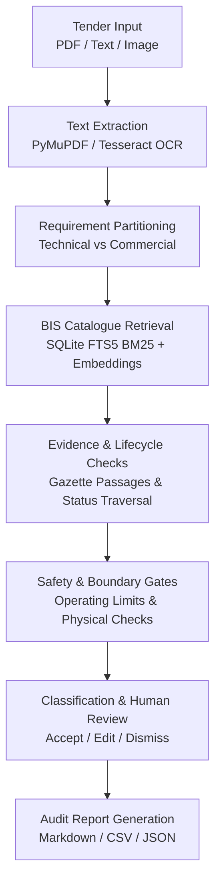

# Tender Saathi

**Find the right Indian Standard for a tender, with supporting evidence.**

[](https://tendersaathi.vercel.app/)
[](https://github.com/syed-imadulla/Tender-saathi)

[](https://www.python.org/)
[-brightgreen.svg)]()
[-brightgreen.svg)]()
[]()
[]()

> **Smart India Hackathon (SIH) — Problem Statement ID: SIH26108**  
> An open-source, evidence-backed decision-support system for technical tender specification auditing against Bureau of Indian Standards (BIS) codes.

---

## Table of Contents

1. [The Problem We Are Solving](#the-problem-we-are-solving)
2. [Our Solution](#our-solution)
3. [See It in Action](#see-it-in-action)
4. [How It Works](#how-it-works)
5. [How Recommendations Are Classified](#how-recommendations-are-classified)
6. [BIS Data Coverage](#bis-data-coverage)
7. [Features](#features)
8. [Testing and Benchmarks](#testing-and-benchmarks)
9. [Technology Stack](#technology-stack)
10. [Quick Start](#quick-start)
11. [API Overview](#api-overview)
12. [Known Limits and Next Steps](#known-limits-and-next-steps)
13. [Documentation and Project Details](#documentation-and-project-details)

---

## The Problem We Are Solving

Public procurement officers in Indian government departments and public sector enterprises handle complex tender documents. A single public works, water supply, or electrical tender often contains dozens of distinct technical requirements.

When specifying items, procurement officers must reference the correct Indian Standards (BIS codes). To do this accurately, they must verify:
- The exact engineering requirement (material, grade, pressure, diameter, and temperature conditions).
- The correct standard code, part number, and current edition year.
- The lifecycle status (whether the standard is active, superseded by a newer edition, or withdrawn).
- Essential companion codes (normative references, mandatory laboratory test methods, and installation practices).
- The supporting clause text proving that the standard genuinely applies to the specified item.

Today, officers often rely on manual keyword searches across the BIS portal or generic web search engines. **Finding a possible standard is easy compared with proving that it fits the tender.**

A search result alone does not prove applicability. If a tender cites a withdrawn standard, an incorrect pressure class, or an ungrounded clause, it creates serious risks during public bidding, factory inspection, laboratory quality testing, and statutory audit.

---

## Our Solution

Tender Saathi assists procurement officers by systematically analyzing tender documents against authoritative Bureau of Indian Standards records.

### How It Works from the User's Perspective

1. **Submit Input**: Upload a tender PDF, upload an image of a tender notice, or paste raw specification text.
2. **Extract & Split**: The system extracts clean text and automatically separates commercial boilerplate (EMD, bank guarantee, turnover criteria) from genuine technical requirements.
3. **Search the Catalogue**: It matches technical requirements across 35,208 BIS catalogue records using fast lexical search (SQLite FTS5 BM25) and dense semantic retrieval.
4. **Verify Evidence & Lifecycle**: It cross-checks candidate standards against authentic indexed statutory gazette passages, active edition years, and known companion codes.
5. **Classify Transparency**: Recommendations are clearly classified into evidence tiers (`CLAUSE_VERIFIED` vs `CATALOGUE_DISCOVERED` vs `SAFE_ABSTENTION`).
6. **Flag Review Needs**: Missing engineering parameters, superseded standards, and uncertain matches are routed to an interactive human review queue.
7. **Retain Review History & Export**: Officers can review, approve, edit, or dismiss recommendations with notes, then export clean Markdown, JSON, or CSV audit reports.

### Why This Is Different from a Basic Chatbot

Generic large language model chatbots frequently hallucinate plausible-sounding BIS standard numbers and invent non-existent clauses.

Tender Saathi separates catalogue metadata discovery from clause-backed verification:
- It **never fabricates standard numbers**: every recommendation must resolve to an authentic BIS catalogue record.
- It **never invents clause text**: if a standard exists in the catalogue but its full normative text is not yet indexed in our verified corpus, the system flags it honestly as `CATALOGUE_DISCOVERED` and asks for human review.
- It **safely abstains**: when a requirement is purely commercial or physically contradictory, it abstains instead of guessing.

---

## See It in Action

Try the live deployment directly in your browser:  
🔗 **[https://tendersaathi.vercel.app/](https://tendersaathi.vercel.app/)**

### 3 Representative Demo Scenarios

You can verify these directly in the live UI or using the test fixtures in this repository:

#### 1. Supported Technical Requirement (CPVC Pipe)
- **Input Text**: *"Chlorinated polyvinyl chloride pipes for potable hot and cold water supplies, SDR 11, working pressure 1.0 MPa at 82 deg C."*
- **Observed Result**: Recommends **IS 15778 : 2007** (Active).
- **Evidence Tier**: `CLAUSE_VERIFIED` (Green badge).
- **Supporting Detail**: Displays authentic gazette clause evidence (Clause 4.1 material requirements, Clause 6.2 dimensions) and links companion solvent cement standard **IS 14182**.

#### 2. Mixed Tender (Technical Requirements + Commercial Terms)
- **Input Text**: *"Item 1: PVC insulated unsheathed copper conductor cables for electrical wiring conforming to IS 694. Item 2: EMD amount of INR 1,50,000 shall be submitted online. Performance security of 10% valid for 12 months."*
- **Observed Result**:
  - Item 1 correctly maps to **IS 694 : 2010** (`CLAUSE_VERIFIED`).
  - Item 2 (EMD and performance security) is recognized as procurement boilerplate and excluded from standards matching (`candidate_standard=None`, `SAFE_ABSTENTION`). Zero standards hallucinated.

#### 3. Catalogue-Only Discovery (Human Review Required)
- **Input Text**: *"Self-contained open-circuit compressed air breathing apparatus for industrial rescue operations."*
- **Observed Result**: Identifies candidate standard **IS 10245 (Part 2) : 1996**.
- **Evidence Tier**: `CATALOGUE_DISCOVERED` (Amber badge).
- **Notice Shown**: Discloses that the standard was matched from catalogue metadata, but its full gazette clause text is not yet indexed in the verified corpus. Directly flags `human_review_required=True` for officer sign-off.

### Hackathon Presentation Guides
- 📖 **[5-Minute Live Presentation Script](docs/demo/SIH_LIVE_DEMO.md)**: Timed click-by-click presenter instructions with backup fallback options.
- 📖 **[Judge Technical Q&A Guide](docs/demo/JUDGE_QA.md)**: Detailed answers to 10 common technical questions asked by hackathon evaluators.

---

## How It Works



### Main Pipeline Stages

1. **Text Extraction**: Uses PyMuPDF for digital-text PDFs, preserving tabular structures. Falls back to Tesseract OCR (with English and Hindi models) when image scans are detected.
2. **Requirement Partitioning**: Strips procurement terms, payment conditions, and penalty clauses so retrieval focuses strictly on engineering specifications.
3. **Catalogue Search**: Executes pure-Python BM25 and SQLite FTS5 queries against 23,510 active BIS catalogue records, supplemented by local MiniLM semantic embeddings.
4. **Evidence Grounding**: Checks whether the standard belongs to the verified statutory gazette corpus (`corpus.db`). If present, it retrieves verbatim clause passages.
5. **Boundary & Lifecycle Gates**: Verifies pressure, temperature, and medium constraints. Checks if the standard is superseded or withdrawn.
6. **Human Review & Reporting**: Stores reviewer decisions and produces downloadable audit reports with complete provenance trails.

---

## How Recommendations Are Classified

Tender Saathi uses three clear classification tiers to communicate its level of evidence:

| Result Tier | Meaning | Recommended Next Step |
| :--- | :--- | :--- |
| **`CLAUSE_VERIFIED`** | Supporting clause text exists in our indexed statutory gazette corpus. | Review the excerpted clause passage and confirm that it fits the tender scope. |
| **`CATALOGUE_DISCOVERED`** | A possible standard was identified through BIS catalogue metadata, but full-text clause evidence is not yet indexed in our verified corpus. | Human review is required. Inspect the official standard document before purchasing. |
| **`SAFE_ABSTENTION`** / **Review Required** | Available evidence is insufficient, or the clause is purely commercial, ambiguous, or physically incompatible. | Clarify the engineering requirements or seek review from a subject expert. |

> **Transparency Note**: These tiers describe the system's verified data coverage. They provide decision support and do not constitute statutory or legal certification.

---

## BIS Data Coverage

Current database counts verified during the Phase 38 production audit:

| Database File | Key Table | Records | Coverage Details |
| :--- | :--- | :--- | :--- |
| **`data/catalogue/bis_catalogue.db`** | `standards` | **35,208** | Full BIS catalogue snapshot: **10,828** Active, **13,024** Unknown status, **11,340** Withdrawn, and **16** Superseded. |
| **`data/catalogue/catalogue_search_index.db`** | `catalogue_fts` | **23,510** | FTS5 BM25 search index containing all active and unwithdrawn catalogue records. |
| **`data/standards/corpus.db`** | `corpus_passages` | **53 passages** | Authentic statutory gazette passages covering **13 foundational standards** (`CLAUSE_VERIFIED` baseline). |
| **`data/standards/standards.db`** | `standards` | **99 standards** | Curated engineering standards with **197 verified relationship links** (companion codes, test methods, installation guides). |

**Important Distinction**: Catalogue metadata coverage (35,208 records) is much broader than authentic clause-level evidence coverage (13 standards, 53 passages). The system never pretends that unindexed standards have verified clause passages.

---

## Features

### 1. Document Ingestion & Extraction
- Native PDF extraction via PyMuPDF without OCR degradation for digital-text tenders.
- Optical Character Recognition (OCR) fallback via Tesseract for scanned documents and images.
- Rejection of corrupted or malformed files with clear HTTP 400 Client Error messages.

### 2. Specification Analysis & Retrieval
- Automatic separation of technical specifications from commercial boilerplate.
- Fast keyword search across 23,510 active standards using SQLite FTS5 BM25.
- Offline-capable dense semantic embeddings (Sentence-Transformers MiniLM).

### 3. Engineering Safety & Conflict Gates
- Operating condition checks for temperature, pressure, medium, and material compatibility.
- Detection of physical contradictions (e.g. unplasticized PVC specified for high-temperature steam).
- Supersedence tracking that prevents withdrawn standards from being silently marked active.

### 4. Standards Relationship Graph
- Directed graph tracking 8 relationship types: normative references, test methods, installation codes, safety codes, amendments, and superseding standards.
- Strict depth-1 traversal prevents unrelated standards from being pulled in.

### 5. Officer Review & Decision Audit Trail
- Interactive review queue allowing procurement officers to **Accept**, **Edit**, or **Dismiss** recommendations.
- Persistent reviewer notes and decision timestamps.
- Formatted report exports in **Markdown**, **JSON**, and **CSV** (with protection against spreadsheet formula injection).

---

## Testing and Benchmarks

We separate automated software verification from recommendation accuracy benchmarks.

### Software Verification Suite

Every test command below passes cleanly:

| Test Scope | Target / Command | Tests | Pass Rate | Status |
| :--- | :--- | :--- | :--- | :--- |
| **Phase 38 Reality Check Suite** | `python3 -m pytest tests/test_phase38_production_reality.py` | 12 | **100% (12/12)** | Passed |
| **Full Backend Test Suite** | `python3 -m pytest tests/` | 819 | **100% (819/819)** | Passed (204s) |
| **Phase 37 Demo Packaging** | `python3 -m pytest tests/test_phase37_demo_packaging.py` | 8 | **100% (8/8)** | Passed |
| **Frontend Unit & Component** | `cd frontend && npx vitest run` | 12 | **100% (12/12)** | Passed |
| **Frontend Production Build** | `cd frontend && npm run build` | — | **Success** | Built in 1.86s |
| **Docker Compose Config** | `docker compose config` | — | **Valid** | Exit code 0 |
| **Backend Container Health** | `curl -f http://localhost:5000/api/health` | — | **HTTP 200** | Status OK |

### Recommendation Benchmark Disclosure

- Our current evaluation baseline ([`dataset/ground_truth/ground_truth.csv`](dataset/ground_truth/ground_truth.csv)) contains **20 representative tender cases** and **5 negative controls** (SHA-256: `8bcc9bc59b8cc69f418626325238fc9f0be24429950a9f78a736177c086e3cfc`).
- On this small initial set, the system achieves 90% Top-1 retrieval recall and 100% negative control rejection.
- **Honest Disclose**: These ground-truth labels have been assembled internally and have **not yet been independently audited by accredited BIS sectional committees**. We do not present this small benchmark as a proven real-world accuracy figure across all procurement domains.

For detailed evaluation methodologies, see:
- 📊 **[Benchmark Evaluation Report](docs/evaluation/benchmark.md)**
- 🛡️ **[Adversarial Robustness Suite](docs/evaluation/adversarial_suite.md)**
- ⚠️ **[System Boundaries & Limitations](docs/evaluation/limitations.md)**
- 📋 **[Phase 38 Production Reality Check Audit](docs/evaluation/PHASE38_PRODUCTION_REALITY_CHECK.md)**

---

## Technology Stack

| Layer | Technologies Used | Purpose |
| :--- | :--- | :--- |
| **Frontend UI** | React 18, TypeScript, Vite, D3.js | Single-page application with interactive standards graph visualization |
| **Backend API** | Python 3.11, Flask, Gunicorn | REST endpoints and analysis orchestration |
| **Search Engine** | SQLite3, FTS5 BM25 | Instant pure-Python lexical retrieval across 23,510 active records |
| **Semantic Retrieval**| PyTorch (CPU-only build), Sentence-Transformers | Dense vector similarity for domain-specific terminology |
| **Document Processing**| PyMuPDF (fitz), Tesseract OCR, Poppler | PDF text parsing, table isolation, and scanned image OCR |
| **Testing** | Pytest, Vitest | Automated backend and frontend regression test suites |
| **Deployment** | Docker, Docker Compose, Nginx (Alpine) | Multi-container packaging with reverse proxy and persistent volumes |

---

## Quick Start

You can run Tender Saathi using either Docker Compose or local Python/Node environments.

### Method 1: Docker Compose (Recommended)

Requires Docker and Docker Compose installed:

```bash
# 1. Clone the repository
git clone https://github.com/syed-imadulla/Tender-saathi.git
cd Tender-saathi

# 2. Prepare environment variables
cp .env.example .env

# 3. Build and start containers in background
docker compose up -d --build

# 4. Check container status
docker compose ps
```

- **Web Interface**: `http://localhost:3000` (Nginx proxies `/api/` calls to backend)
- **Backend Health Check**: `http://localhost:5000/api/health`

### Method 2: Local Development Setup (Without Docker)

#### Prerequisites
- Python 3.10 or higher
- Node.js 18 or higher with npm

#### Step 1: Start Backend API
```bash
python3 -m venv venv
source venv/bin/activate
pip install -r requirements.txt

export FLASK_APP=api/server.py
python3 -m flask run --port 5000
```

#### Step 2: Start Frontend UI (In a second terminal)
```bash
cd frontend
npm install
npm run dev
```
- Open `http://localhost:5173` in your browser.

For complete setup instructions, see the **[Installation Guide](docs/getting-started/installation.md)**.

---

## API Overview

The Flask backend (`api/server.py`) provides the following main REST endpoints:

| Method | Endpoint | Description |
| :--- | :--- | :--- |
| `GET` | `/api/health` | Returns backend health status and OCR readiness |
| `POST` | `/api/analyze/text` | Submit plain text tender requirements for analysis |
| `POST` | `/api/analyze/pdf` | Upload digital or scanned tender PDF for analysis |
| `POST` | `/api/analyze/image` | Upload tender image for OCR analysis |
| `GET` | `/api/analyze/sample/<demo>` | Run pre-configured demo cases (`cpvc`, `valve`, `superseded`) |
| `GET` | `/api/standards/search` | Search BIS catalogue by keyword or standard number |
| `GET` | `/api/standards/<id>/neighbors`| Fetch depth-1 related standards from the relationship graph |
| `POST` | `/api/tender/<id>/review` | Submit officer review decisions (`ACCEPT`, `EDIT`, `DISMISS`) |
| `GET` | `/api/report/<id>/markdown` | Download audit report in Markdown format |
| `GET` | `/api/report/<id>/csv` | Download audit report in CSV format (sanitized against injection) |
| `GET` | `/api/report/<id>/json` | Download complete audit report in structured JSON format |

For complete request and response schemas, see the **[REST API Reference](docs/api/rest_api.md)**.

---

## Known Limits and Next Steps

Tender Saathi is built on honest engineering principles. Here are our current operational boundaries:

1. **Clause Evidence Scope**: Verbatim statutory gazette clauses are currently indexed for **13 foundational standards** (53 passages). The remaining 23,497 active catalogue standards are matched via FTS5 BM25 metadata and flagged as `CATALOGUE_DISCOVERED`.
2. **Catalogue Status Gaps**: In the open BIS catalogue snapshot, 13,024 records lack an explicit Active/Withdrawn tag and are classified as `UNKNOWN`. These require official gazette verification.
3. **Scanned PDF Quality**: Highly degraded scans (<150 DPI), skewed images, or handwritten notes will reduce OCR text extraction quality.
4. **Curated Relationship Horizon**: The standards relationship graph contains 197 verified edges across demonstration domains; it does not map every relationship in the complete national catalogue.
5. **Human Decision-Making Required**: This tool is an advisory decision-support assistant. Procurement officers must review and confirm all recommendations before issuing tender notices.

### Next Priorities

- **Expand Gazette Clause Coverage**: Ingest and index gazette editions for high-frequency infrastructure domains (cement, steel, transformers).
- **Automated Lifecycle Sync**: Build scheduled connectors to refresh status flags directly from the Bureau of Indian Standards portal.
- **Independent Expert Benchmark**: Partner with domain procurement specialists to create a verified, multi-domain benchmark covering hundreds of real tenders.

---

## Documentation and Project Details

| Category | Document | Description |
| :--- | :--- | :--- |
| **Presentation & Live Demo** | [SIH Live Demo Script](docs/demo/SIH_LIVE_DEMO.md) | 5-minute timed presenter walkthrough with click-by-click instructions |
| | [Judge Technical Q&A](docs/demo/JUDGE_QA.md) | Detailed answers to 10 common hackathon judge evaluation questions |
| **Architecture & Design** | [Architecture Overview](docs/architecture/overview.md) | Pipeline stages, data flow diagrams, and safety invariants |
| | [Module Reference](docs/architecture/modules.md) | Descriptions of backend components in `src/` |
| | [Relationship Graph](docs/architecture/relationship_graph.md) | Directed graph schema and 8 canonical relationship types |
| **Evaluation & Audits** | [Phase 38 Reality Check](docs/evaluation/PHASE38_PRODUCTION_REALITY_CHECK.md) | Complete end-to-end audit, test metrics, and database verification |
| | [Benchmark Evaluation](docs/evaluation/benchmark.md) | Retrieval accuracy, Mean Reciprocal Rank (MRR), and negative controls |
| | [Adversarial Test Suite](docs/evaluation/adversarial_suite.md) | 70-probe stress testing across 14 failure categories |
| | [System Limitations](docs/evaluation/limitations.md) | Full boundary conditions and operational limits disclosure |
| **Getting Started** | [Installation Guide](docs/getting-started/installation.md) | Local environment setup, dependencies, and troubleshooting |
| | [Configuration Guide](docs/getting-started/configuration.md) | Environment variables, offline modes, and database paths |
| | [REST API Reference](docs/api/rest_api.md) | Endpoint specifications, payload examples, and response formats |

---

## Disclaimer & Attribution

- **Hackathon Attribution**: Developed for the **Smart India Hackathon (SIH)** under **Problem Statement SIH26108**.
- **Data Source**: Standards catalogue metadata is derived from public records published by the **Bureau of Indian Standards (BIS)**.
- **Independent Project Disclaimer**: Tender Saathi is an independent decision-support tool created for hackathon evaluation. It is **not** an official application of the Bureau of Indian Standards, the Government of India, or any statutory authority. It does not provide legal, structural, or certified quality guarantees.
