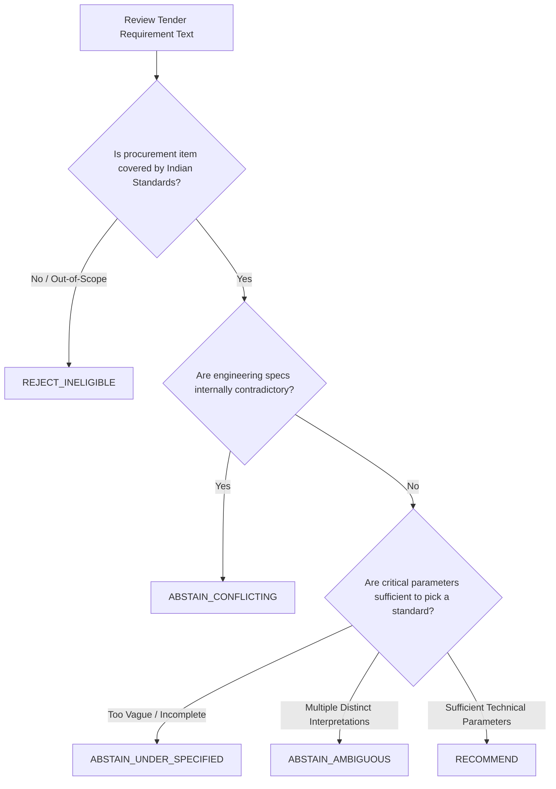

# Tender Saathi — Domain Expert Adjudication Rubric & Protocol

**Document Version**: 1.0.0 (Phase 13)  
**Target Audience**: CPWD Engineers, BIS Technical Officers, Public Procurement Auditors  
**System**: Tender Saathi (SIH26108) — AI Standards Recommendation Engine  

---

## 1. Role & Objective of the Expert Adjudicator

Tender Saathi assists public procurement officers in identifying applicable Indian Standards (BIS) from tender specifications. In government procurement (CPWD, Railways, Defence, PSUs), recommending an incorrect or obsolete standard leads to procurement disputes, rejected tenders, or structural failures.

Your role as an Expert Adjudicator is to establish the ground truth for benchmark evaluation. For each tender requirement presented in a **Case Review Packet**, you must independently determine:
1. Whether the specification is answerable with existing Indian Standards.
2. If answerable, exactly which Indian Standards apply and at what specific clause level.
3. If not answerable, why the system must safely abstain from making a recommendation.

---

## 2. Canonical Adjudication Decision Taxonomy

You must classify each requirement into exactly **one** of the following 5 canonical decisions:

### 1. `RECOMMEND`
- **Definition**: The requirement provides sufficient technical specificity (e.g. material type, application, grade, diameter, pressure, or voltage) to identify one or more applicable Indian Standards.
- **Evidence Requirement**:
  - You must list the primary Indian Standard(s) (e.g. `IS 15905 : 2011`, `IS 458 : 2021`).
  - You must cite the specific standard clause (e.g. `Clause 1 Scope`, `Clause 4.2 Material Properties`).
  - The standard must be currently active or reaffirmed in the BIS catalogue. If the standard is superseded (e.g., `IS 10611`), you must cite the current active successor (`IS/ISO 10434`).
- **Example**:
  - *Tender Text*: *"Replacement of damaged toilet drainage pipelines by Hubless cast iron pipes."*
  - *Decision*: `RECOMMEND`
  - *Applicable Standards*: `IS 15905 : 2011; IS 1239 (Part 1) : 2004`
  - *Clause Reference*: `IS 15905 Clause 1 (Scope of Hubless Soil and Waste Pipes)`

### 2. `ABSTAIN_UNDER_SPECIFIED`
- **Definition**: The requirement refers to an equipment or material class governed by standards, but **lacks critical engineering parameters** needed to distinguish between multiple mandatory standards.
- **Criterion**: If selecting a standard requires guessing the operating conditions, line size, pressure rating, or material chemistry, the correct system action is to **abstain and request human clarification**.
- **Example**:
  - *Tender Text*: *"Valve Replacement in plant chemical maintenance services."*
  - *Decision*: `ABSTAIN_UNDER_SPECIFIED`
  - *Missing Parameters*: Fluid media, operating temperature, pressure rating class (150/300), nominal bore (DN), and valve mechanism (gate, globe, butterfly, ball).
  - *Why NOT RECOMMEND*: Recommending `IS 778` (bronze water valve) for high-pressure chemical service is hazardous; recommending `IS 14846` (sluice valve) is speculative without piping class.

### 3. `ABSTAIN_AMBIGUOUS`
- **Definition**: The tender requirement contains language that equally points to two or more mutually exclusive standards for distinct procurement objects, and no surrounding context resolves the ambiguity.
- **Example**:
  - *Tender Text*: *"Supply of 100mm heavy duty pipes for underground services."*
  - *Decision*: `ABSTAIN_AMBIGUOUS`
  - *Why*: Could be precast concrete sewer pipe (`IS 458`), ductile iron water pipe (`IS 8329`), or HDPE pipe (`IS 14333`).

### 4. `ABSTAIN_CONFLICTING`
- **Definition**: The requirement contains mutually exclusive or technically contradictory specifications.
- **Example**:
  - *Tender Text*: *"Supply of Unplasticized PVC pipes conforming to IS 1239 (Part 1) steel tube specification."*
  - *Decision*: `ABSTAIN_CONFLICTING`
  - *Why*: `IS 1239` strictly covers mild steel tubes; UPVC pipes are governed by `IS 4985`. The tender conflates plastic and steel standards.

### 5. `REJECT_INELIGIBLE`
- **Definition**: The requirement is outside the scope of Bureau of Indian Standards product/process standardization (e.g., proprietary IT software licenses, synthetic negative distractors, human catering operations without BIS specification).
- **Example**:
  - *Tender Text*: *"Annual subscription renewal for Oracle Enterprise Database cloud software licenses."*
  - *Decision*: `REJECT_INELIGIBLE`

---

## 3. Evidence Verification Standards

To be accepted into Tender Saathi's Gold Benchmark:
1. **Clause-Level Evidence**: Every positive recommendation must cite a real clause from the official standard. Citing only the standard number without reading its scope clause is unacceptable.
2. **Lifecycle Check**: Reviewers must verify that the standard has not been withdrawn or replaced.
3. **Subcomponent Integrity**: For composite procurement requirements (e.g., "SITC of VFD Water Booster Pump Panel"), reviewers should identify both the drive standard (`IS/IEC 61800-2`) and the enclosure/panel assembly standard (`IS/IEC 61439-2`).

---

## 4. Two-Party Consensus Protocol

1. Each case packet is reviewed independently by **two qualified domain experts** (Reviewer A and Reviewer B).
2. If both adjudicators submit identical `expected_decision` and compatible standards, the case is automatically verified (`consensus_status: REACHED`).
3. If adjudicators differ (e.g. Reviewer A recommends `IS 7098 Part 1` and Reviewer B flags `ABSTAIN_UNDER_SPECIFIED`), the case is submitted to an Adjudication Committee with both expert rationales attached.
