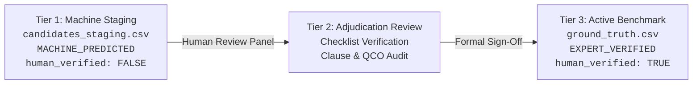

# Tender Saathi — Ground Truth Governance & Adjudication Protocol

## 1. Executive Summary

This standard operating procedure (SOP) defines the governance protocol, review checklist, and anti-falsification controls for creating, adjudicating, and promoting evaluation benchmark cases for Tender Saathi.

In public procurement, incorrect standard recommendations carry severe legal, commercial, and structural safety liabilities. Consequently, **the evaluation ground truth is held to strict forensic standards**.

---

## 2. Three-Tier Dataset Architecture

To guarantee scientific integrity and prevent training or evaluation contamination, Tender Saathi enforces strict physical and operational segregation across three tiers:



### Tier 1: Machine Staging (`dataset/ground_truth/candidates_staging.csv`)
- Generated autonomously by `scripts/expand_ground_truth.py` from raw tender files in `tenders/raw/`.
- **Mandatory Flags**:
  - `adjudication_status = "MACHINE_PREDICTED"`
  - `human_verified = FALSE`
  - `reviewer_role = ""`
  - `reviewed_at = ""`
- **Isolation Constraint**: Staging files are strictly segregated from the active benchmark. Machine-generated predictions are never automatically merged or scored as ground truth.

### Tier 2: Adjudication Review
- Formal review conducted by a domain expert (civil, electrical, mechanical, or procurement engineer).
- Every proposed requirement is evaluated against the 5-point verification checklist below.

### Tier 3: Active Ground Truth Benchmark (`dataset/ground_truth/ground_truth.csv`)
- The locked 24-column reference dataset used by `src/evaluate.py`.
- **Promotion Rule**: Rows may only be promoted from Tier 1 to Tier 3 when all four CI governance invariants are satisfied.

---

## 3. Four Inviolable CI Governance Invariants (GATE-01)

Automated tests in [`tests/test_ground_truth_integrity.py`](file:///home/syed-imadulla/Desktop/Tender_Saathi/tests/test_ground_truth_integrity.py) automatically block CI/CD pipelines if any row violates these four invariants:

1. **Explicit Adjudication Status**:
   Any row claiming `human_verified: TRUE` MUST have `adjudication_status: "EXPERT_VERIFIED"`. Rows marked `UNVERIFIED_BASELINE` or `MACHINE_PREDICTED` must strictly have `human_verified: FALSE`.
2. **Recognized Reviewer Role**:
   `reviewer_role` must match a certified professional role from the approved role taxonomy:
   - `CPWD_EXECUTIVE_ENGINEER`
   - `CPWD_ASSISTANT_ENGINEER`
   - `BIS_STANDARDS_OFFICER`
   - `MES_PROCUREMENT_OFFICER`
   - `RAILWAY_STANDARDS_ENGINEER`
   - `DOMAIN_EXPERT`
3. **Valid Review Timestamp**:
   `reviewed_at` must contain a valid ISO 8601 date string (e.g. `2026-10-25T14:30:00Z`).
4. **Defensible Evidence Binding**:
   Both `evidence_reference` (e.g. `IS 15905:2011 Clause 1 Scope`) and `evidence_snippet` must be non-empty and cite authoritative BIS or regulatory texts.

---

## 4. Expert Reviewer Checklist

When reviewing candidate requirements in `candidates_staging.csv`, the reviewer must complete the following 5-point verification:

### Step 1: Tender Scope & Requirement Verification
- [ ] Inspect the raw tender PDF in `tenders/raw/` at the cited `source_page`.
- [ ] Verify that `requirement_text` appears verbatim in the tender scope or technical schedule.
- [ ] Confirm that `procurement_sector` accurately classifies the engineering domain.

### Step 2: Decision Classification (`expected_decision`)
Classify the requirement into one of five canonical decision categories:
- **`RECOMMEND`**: The specification provides sufficient engineering parameters (material, grade, pressure rating, dimensions) to unequivocally identify one or more applicable Indian Standards.
- **`ABSTAIN_UNDER_SPECIFIED`**: The clause is too terse or vague (e.g. "Valve Replacement" without line size, pressure, metallurgy, or fluid) to determine a standard without guessing. The system is expected to withhold recommendations and request human review.
- **`ABSTAIN_AMBIGUOUS`**: The text contains contradictory requirements or indeterminate scope where single standard assignment risks non-compliance.
- **`ABSTAIN_CONFLICTING`**: The tender cites conflicting or incompatible specifications.
- **`REJECT_INELIGIBLE`**: Commercial, legal, financial, or non-technical clauses outside BIS technical standardization scope.

### Step 3: Standard Applicability & Title Verification
- [ ] Search the Bureau of Indian Standards (BIS) online portal or `standards.db` for the exact code (e.g., `IS 15778 : 2007`).
- [ ] Confirm the full official standard title in `standard_title`.
- [ ] Ensure multiple co-applicable standards are delimited with semicolons `;`.

### Step 4: Legal & Quality Control Order (QCO) Currency
- [ ] Verify `standard_status`: Confirm whether the standard is `Active` or `Superseded`.
- [ ] If superseded, identify the superseding standard in `reviewer_notes` (e.g. `IS 15622` superseded `IS 13753`).
- [ ] Check whether an active Ministry Quality Control Order (QCO) mandates ISI mark certification (e.g., *CPVC Pipes QCO 2023*, *Ceramic Tiles QCO 2020*).

### Step 5: Evidence Grounding Snippet
- [ ] Cite the definitive standard clause in `evidence_reference` (e.g., `IS 15778:2007 Clause 1 Scope, Clause 5.1 Dimensions`).
- [ ] Provide a factual excerpt in `evidence_snippet` proving standard applicability to the cited procurement item.
- [ ] Write a plain-language engineering justification in `reasoning`.

---

## 5. Promotion Procedure to Active Ground Truth

1. Create a promotion branch: `git checkout -b chore/ground-truth-adjudication-batch-<N>`.
2. Move reviewed rows from `dataset/ground_truth/candidates_staging.csv` to `dataset/ground_truth/ground_truth.csv`.
3. Set:
   ```csv
   human_verified: TRUE
   adjudication_status: EXPERT_VERIFIED
   reviewer_role: <CERTIFIED_ROLE>
   reviewed_at: <ISO_TIMESTAMP>
   ```
4. Run provenance audit and integrity tests:
   ```bash
   python3 scripts/audit_ground_truth_provenance.py
   pytest tests/test_ground_truth_integrity.py
   ```
5. Update `tests/test_adversarial_suite.py` with the new frozen dataset SHA-256 hash.
6. Submit pull request with signed expert review documentation attached.
