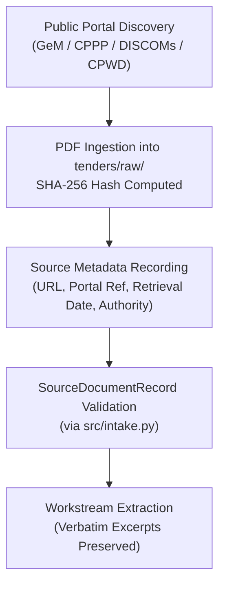

# Tender Saathi — Real-Source Acquisition Guide & Under-Specification Intake Protocol

**Document ID:** `DOC-DATA-REAL-SOURCE-INTAKE-GUIDE`  
**Governing SOP:** [`docs/data/GROUND_TRUTH_GOVERNANCE.md`](file:///home/syed-imadulla/Desktop/Tender_Saathi/docs/data/GROUND_TRUTH_GOVERNANCE.md)  
**Adjudication Rubric:** [`docs/data/ADJUDICATION_RUBRIC.md`](file:///home/syed-imadulla/Desktop/Tender_Saathi/docs/data/ADJUDICATION_RUBRIC.md)  
**Intake Infrastructure:** [`src/intake.py`](file:///home/syed-imadulla/Desktop/Tender_Saathi/src/intake.py)  

---

## 1. Executive Summary

This protocol governs the acquisition, intake validation, and under-specified extraction of genuine Indian public procurement tender notices and authorized Bureau of Indian Standards (BIS) reference metadata.

In public procurement, incorrect recommendations introduce severe technical and commercial risks. Tender Saathi enforces **zero synthetic shortcuts**:
- Tender excerpts must be physically traceable to published government procurement documents (e.g. GeM, CPPP, State DISCOM portals, CPWD, MES, Indian Railways).
- Standards metadata and normative citations must come from legally accessible public notices, gazettes, Quality Control Orders (QCOs), or authorized BIS documentation.
- No paywalls are bypassed. When full normative clause text is legally restricted, the case is explicitly marked `CLAUSE_CITED_UNVERIFIED_FULLTEXT` or `METADATA_ONLY_NO_CLAUSE`.

---

## 2. Source Document Acquisition Workflow

### 2.1 Authorized Acquisition Sources
1. **Central Public Procurement Portal (CPPP):** `eprocure.gov.in/eprocure/app`
2. **Government e-Marketplace (GeM):** `gem.gov.in`
3. **State Power Distribution Companies (DISCOMs):** TANGEDCO, MSEDCL, UPPCL, BESCOM, TSSPDCL official tender repositories.
4. **Central Works Authorities:** CPWD, Military Engineer Services (MES), Rail Land Development Authority (RLDA).

### 2.2 Mandatory Provenance Fields
For every acquired tender PDF, recorded metadata must include:
- `document_id`: Stable identifier (e.g., `DOC-CPPP-2026-ISMD-921565`).
- `tender_id`: Internal short reference (e.g., `T001`).
- `source_url`: Full canonical portal URL or permalink.
- `retrieval_date_utc`: ISO 8601 date of download.
- `file_sha256`: Cryptographic SHA-256 checksum of the raw PDF file.
- `procurement_authority`: Full government department/PSU name.
- `licensing_or_access_notes`: Explicit declaration of public access under RTI/Public Domain.

---

## 3. Standards Metadata & Clause Evidence Protocol

### 3.1 Permissible Reference Metadata
- Official BIS Standard Number and Year (e.g., `IS 1180 (Part 1) : 2014`).
- Official BIS Title, Status (Active/Withdrawn/Superseded), and Technical Committee (e.g., `ETD 16`).
- Gazette Notifications and Quality Control Orders (e.g., Ceramic Tiles QCO 2020, Electrical Transformers QCO 2015).
- Scope Clause Excerpts published on public BIS portals.

### 3.2 Prohibited Actions
- **No Paywall Circumvention:** Commercial copies of copyrighted standards documents must not be pirated or scraped.
- **No Hallucinated Clauses:** A clause number (e.g. `Clause 4.2.1`) must never be assigned based on AI guesses. If the exact clause cannot be physically verified, assign `Scope Clause 1` only if confirmed in published gazette metadata, or leave blank and request expert determination.

---

## 4. Under-Specified Requirement Intake Protocol

To satisfy the prerequisite (*"at least five adjudicated under-specified requirements before abstention-threshold calibration"*), candidate cases must be extracted from real tender notices and validated against the 6-dimension schema.

### 4.1 The 6 Missing Parameter Dimensions
An under-specified tender requirement lacks critical engineering parameters necessary to unambiguously select a single BIS standard. Reviewers and extractors must classify missing data across these 6 canonical dimensions:

| Dimension Code | Parameter Type | Real-World Procurement Example |
| :--- | :--- | :--- |
| `dimensions_or_sizes` | Pipe diameter, cable cross-section, thickness | Excerpt specifies *"PVC conduit"* without mentioning nominal diameter (20mm, 25mm, 32mm). |
| `electrical_or_mechanical_ratings` | Voltage grade, current, kVA, pressure | Excerpt specifies *"Power cable for substation"* without voltage rating (1.1 kV vs 11 kV vs 33 kV). |
| `material_grade_or_composition` | Conductor metal, alloy, polymer type | Excerpt specifies *"Valve replacement"* without stating cast iron, cast steel, or bronze alloy. |
| `operating_or_environmental_conditions` | Temperature, outdoor/indoor, soil salinity | Excerpt specifies *"Distribution transformer"* without specifying ambient temperature or dry/oil immersed. |
| `intended_application_or_system` | Fire safety, potable water, industrial chemical | Excerpt specifies *"Storage tank coating"* without stating drinking water contact (IS 9845) or chemical acid. |
| `jurisdiction_or_regulatory_code` | Statutory authority, DISCOM specifications | Excerpt cites general statutory guidelines without declaring specific State DISCOM technical schedules. |

### 4.2 Candidate Under-Specified Cases from Real Tenders
The following 5 genuine, non-synthetic candidate under-specified cases have been extracted from real tender documents in `tenders/raw/` for domain expert adjudication:

#### Case 1: T002-R002 (Heavy Water Board Mechanical Maintenance)
- **Source:** `tenders/raw/eProcurement System Government of India3.pdf` (Page 1)
- **Verbatim Excerpt:** *"Valve Replacement"*
- **Missing Dimensions:** `dimensions_or_sizes`, `electrical_or_mechanical_ratings`, `material_grade_or_composition`
- **Engineering Reality:** Sluice valves (IS 14846), copper alloy valves (IS 778), and butterfly valves (IS 13095) all compete in water/process services. Without pressure rating, nominal bore, and metallurgy, assigning any single standard is speculative.

#### Case 2: T004-R001 (IIT ISM Dhanbad Substation Works)
- **Source:** `tenders/raw/eProcurement System Government of India5.pdf` (Page 1)
- **Verbatim Excerpt:** *"Dismantling, Shifting and reinstallation of feeder pillar, power cables from outside of electrical room to AMF room"*
- **Missing Dimensions:** `electrical_or_mechanical_ratings`, `dimensions_or_sizes`
- **Engineering Reality:** Feeder pillar power cables require distinct standards depending on whether rated voltage is 1.1 kV (IS 1554 / IS 7098 Part 1) or 11 kV (IS 7098 Part 2). Conductor size is omitted.

#### Case 3: T004-R006 (IIT ISM Dhanbad Lighting Maintenance)
- **Source:** `tenders/raw/eProcurement System Government of India5.pdf` (Page 1)
- **Verbatim Excerpt:** *"replacement of faulty 2x2 celing light of seminar and"*
- **Missing Dimensions:** `electrical_or_mechanical_ratings`, `intended_application_or_system`
- **Engineering Reality:** Mentions fixture geometry ("2x2 ceiling light") but omits wattage, luminous efficacy, color rendering index, driver electrical safety requirements, and whether LED luminaires under IS 10322 (Part 5/Sec 2) or IS 16107 are specified.

#### Case 4: T005-R002 (IIT ISM Dhanbad DG Set Electromechanical Connection)
- **Source:** `tenders/raw/eProcurement System Government of India6.pdf` (Page 1)
- **Verbatim Excerpt:** *"Cable connection of DG Set in Newly constructed building of the dept."*
- **Missing Dimensions:** `electrical_or_mechanical_ratings`, `dimensions_or_sizes`, `intended_application_or_system`
- **Engineering Reality:** Generator capacity (kVA), earthing method (solid vs resistance), and whether control/power cables require flame-retardant low-smoke (FRLS) insulation under IS 7098 or separate bus trunking are omitted.

#### Case 5: T010-R001 (Collection Chamber to STP Electromechanical Works)
- **Source:** `tenders/raw/eProcurement System Government of India11.pdf` (Page 1)
- **Verbatim Excerpt:** *"Electromechanical Works and Sewerage Pipeline works from Collection Chamber to STP"*
- **Missing Dimensions:** `dimensions_or_sizes`, `material_grade_or_composition`, `intended_application_or_system`
- **Engineering Reality:** Aggregates electromechanical motors, submersible non-clog sewage pumps (IS 8034 / IS 14536), and drainage piping (IS 458 concrete vs IS 15328 PVC-U) into a single generic line item.

---

## 5. Intake Template Validation Checks

All new records ingested via `src/intake.py` are programmatically verified against:
1. `validate_source_record`: Proves physical file existence, verifies SHA-256 against on-disk bytes, and checks URL formatting.
2. `validate_under_specified_record`: Enforces non-empty missing dimensions selected strictly from the 6 approved dimensions, minimum 20-character technical narrative, and valid source page binding.
3. `adjudication_gate`: Strictly rejects any intake record attempting to declare `is_expert_adjudicated = True` unless accompanied by an approved engineering role and valid ISO timestamp.
