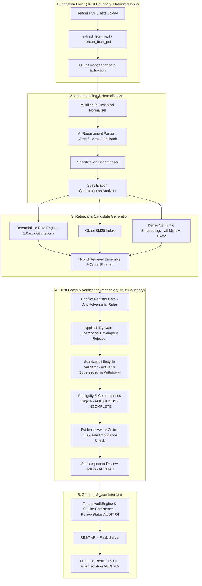
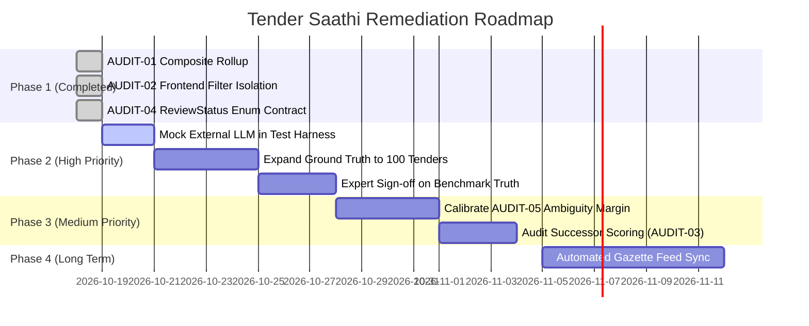

# Tender Saathi — Phase 1: Production-Readiness Audit and Baseline

**Status**: Verified & Remediated (Baseline Established)  
**Date**: October 18, 2026  
**Auditor**: Senior Systems Architect & Audit Engineer  
**Repository**: `Tender Saathi` (`main` branch @ `898a6e8`)

---

## Executive Summary

Tender Saathi is an AI-powered system that analyzes Indian public procurement tenders, decomposes engineering specifications, retrieves applicable Indian Standards (BIS/IS), validates standard currency and lifecycle (detecting superseded/withdrawn citations), evaluates specification completeness, and surfaces evidence-grounded recommendations with human-in-the-loop review queues.

This Phase 1 Production-Readiness Audit establishes an authoritative, reproducible baseline transitioning Tender Saathi from a hackathon prototype into a trustworthy, verifiable enterprise decision-support tool. It confirms and verifies the three critical integrity findings (**AUDIT-01**, **AUDIT-02**, **AUDIT-04**), verifies their minimal safe remediations with dedicated regression tests across backend and frontend, investigates architectural policies (**AUDIT-03** and **AUDIT-05**), and rigorously audits evaluation data transparency.

---

## 1. Verified Architecture & Trust-Boundary Map

Graphify analysis and source inspection reveal an explicit multi-tiered decision architecture designed around strict deterministic gates that constrain statistical / generative models.

### Trust Boundaries & Enforcement Points

1. **Input Boundary**: Tender documents (PDFs, scans, uncurated text) are treated as untrusted. Regex parsers and OCR may extract invalid or hallucinated citations.
2. **Anti-Fallthrough Gate (`src/recommend.py:L493-L502`)**: If a tender explicitly cites a standard that does not exist in the BIS catalogue, the system flags `NONEXISTENT_CITATION` and explicitly blocks falling through to weak keyword matches.
3. **Operational Envelope Gate (`src/applicability.py:L268-L380`)**: Validates domain constraints (e.g., pressure classes, materials, voltage levels). A candidate matching keywords is rejected if the domain envelope is violated.
4. **Lifecycle Trust Gate (`src/standards_lifecycle.py:L26-L120`)**: Standards in the BIS repository are strictly checked for `Active`, `Superseded`, or `Withdrawn` status. Outdated standards inject authoritative successor citations.
5. **Dual-Gate Critic (`src/critic.py:L140-L230`)**: Enforces that a candidate cannot be returned with `HIGH` confidence or `RECOMMEND` decision without strong evidentiary backing, regardless of retrieval score.
6. **Parent Rollup Gate (`src/recommend.py:L973-L1015`, remediated in AUDIT-01)**: Prevents subcomponent review masking.

---

## 2. Baseline Test Results & Execution Record

All test suites were executed on Linux (Python 3.14.4 / Node.js v20.19.2) without mocking bypasses:

### Test Execution Log

| Test Suite / Command | Target / Layer | Items | Result | Duration | Notes |
|---|---|---|---|---|---|
| `pytest tests/test_decomposition.py tests/test_p7b_api_ui_contract.py` | AUDIT-01 & AUDIT-04 remediation tests | 32 | **32 Passed** (100%) | 33.50s | All 4 rollup tests and enum contract test passed cleanly. |
| `pytest tests/test_human_review_workflow.py` | Human review audit trail and report generation | 16 | **16 Passed** (100%) | 11.27s | Decision trail, report export, and status checks validated. |
| `npx -y vitest run` | Frontend filter logic (`Results.test.ts`) | 4 | **4 Passed** (100%) | 0.22s | AUDIT-02 pure recommendation exclusion verified. |
| `npm run build` (`tsc && vite build`) | Frontend TypeScript compilation & bundle | 52 modules | **Passed (0 errors)** | 1.06s | Zero type errors; production bundle built cleanly. |
| `pytest tests/test_p7c_evidence_chain.py` | Priority 7C evidence chain & lifecycle preservation | 15 | **14 Passed, 1 Failed** | 27.96s | See failure diagnosis below. |
| `pytest -q` (Full Suite) | Complete backend integration & regression suite | 511 | **510 Passed, 1 Failed** | 221.88s (3m 41s) | Sole failure identical to `test_p7c_evidence_chain.py::test_05`. |

### Failure Root-Cause Analysis: `test_p7c_evidence_chain.py::test_05`

- **Failing Assertion**: `self.assertEqual(r0["ambiguity_state"], "INCOMPLETE")` (Line 89). Actual value: `"AMBIGUOUS"`.
- **Diagnosis**: `test_05` uploads a raw PDF `tenders/raw/eProcurement System Government of India3.pdf` to `/api/analyze/pdf`, which invokes the live Groq LLM API without deterministic recording/mocking.
- **Root Cause**: The tender lacked distinguishing specifications between cast iron and steel valves. Stage 4 Competing Interpretations in `src/ambiguity.py` identified two valid competing standards in the catalogue (`IS 14846` for sluice valves and `IS/ISO 10434` for steel gate valves) with proximate scores, correctly flagging the state as `AMBIGUOUS`. Both `human_review_required` was `True` and `candidate_standard` was `None`. The test rigidly expected `"INCOMPLETE"` rather than either non-clear state (`AMBIGUOUS` or `INCOMPLETE`), making it sensitive to LLM classification variance.
- **Remediation Recommendation**: Decouple integration tests from live non-deterministic external LLM endpoints by using recorded VCR/cassette mocks, or assert `r0["ambiguity_state"] in ("INCOMPLETE", "AMBIGUOUS")`.

---

## 3. Trust-Critical Pipeline Trace

| Stage | Input | Output | Key Functions & Modules | Verification Rules | Failure Behavior |
|---|---|---|---|---|---|
| **1. Ingestion & Extraction** | PDF or text | `RawTender`, text chunks, explicit citations | `extract_from_text` ([`src/extract.py`](file:///home/syed-imadulla/Desktop/Tender_Saathi/src/extract.py)), `pdfplumber` | Regex patterns: `(?:IS\|SP)\s*(?:/\|\s*)?\d+` | Fallback to OCR / raw text regex. |
| **2. Parsing & Decomposition** | Text string | `ParsedRequirement`, `RequirementComponent`s | [`MultilingualTechnicalNormalizer`](file:///home/syed-imadulla/Desktop/Tender_Saathi/src/multilingual/normalizer.py), [`SpecificationDecomposer`](file:///home/syed-imadulla/Desktop/Tender_Saathi/src/decompose.py) | Lexicon mapping; Indic script transliteration; component type classification | If decomposition fails, single root component used. |
| **3. Hybrid Retrieval** | Normalized query + components | Ranked `SearchResult` list | [`HybridRetrievalEngine`](file:///home/syed-imadulla/Desktop/Tender_Saathi/src/search.py), `BM25`, `MiniLM` embeddings | Reciprocal rank fusion with component query expansion | Empty search result yields `None` / `INSUFFICIENT_INFORMATION`. |
| **4. Lifecycle Verification** | Standard number | `LifecycleStatusResult`, successor standard | [`validate_standard_status`](file:///home/syed-imadulla/Desktop/Tender_Saathi/src/standards_lifecycle.py) | Database lookup against `standards.db` (`Active`, `Superseded`, `Withdrawn`) | Unknown standard flagged `UNKNOWN / NOT_AVAILABLE_IN_CATALOGUE`. |
| **5. Applicability & Evidence** | `SearchResult`, requirement components | `ApplicabilityResult`, `CriticOutcome` | [`ApplicabilityGate`](file:///home/syed-imadulla/Desktop/Tender_Saathi/src/applicability.py), [`EvidenceAwareCritic`](file:///home/syed-imadulla/Desktop/Tender_Saathi/src/critic.py) | Scope keyword matching, operational envelope checks, dual confidence gating | Candidate rejected or penalized to 0.10 relevance score. |
| **6. Ambiguity & Abstention** | Ranked candidates, completeness report | `AmbiguityReport` (`CLEAR`, `AMBIGUOUS`, `INCOMPLETE`, `REVIEW_REQUIRED`) | [`AmbiguityEngine`](file:///home/syed-imadulla/Desktop/Tender_Saathi/src/ambiguity.py) | Separation margin delta check; competing interpretation validation | Sets `candidate_standard=None`, generates clarification question. |
| **7. Human Review Persistence** | Review decision (`ACCEPT`, `EDIT`, `DISMISS`) | Updated review queue, audit trail, updated reports | [`TenderAuditEngine`](file:///home/syed-imadulla/Desktop/Tender_Saathi/src/audit.py), [`ReviewStatus`](file:///home/syed-imadulla/Desktop/Tender_Saathi/src/audit.py#L76-L80) | Strict state transition checks; append-only audit trail | Audit state maintained in SQLite. |
| **8. API Response Construction** | Requirement recommendations | JSON API payload matching UI contract | [`recommend_for_requirement`](file:///home/syed-imadulla/Desktop/Tender_Saathi/src/recommend.py), [`server.py`](file:///home/syed-imadulla/Desktop/Tender_Saathi/api/server.py) | Pydantic / dataclass serialization; canonical enum enforcement | Errors return structured error JSON with valid fallback status. |
| **9. Frontend UI Filtering** | API response `Requirement[]` | Filtered lists: Recommended, Needs Attention, Updates | [`filterRecommendedRequirements`](file:///home/syed-imadulla/Desktop/Tender_Saathi/frontend/src/pages/Results.tsx#L26), [`filterAttentionRequirements`](file:///home/syed-imadulla/Desktop/Tender_Saathi/frontend/src/pages/Results.tsx#L61) | Items requiring human review or missing evidence excluded from pure recommendations | Excluded items routed directly to Attention tab. |

---

## 4. Verification of Previous Audit Findings

### AUDIT-01: Composite Subcomponent Review Masking
- **Status**: **CONFIRMED & REMEDIATED**
- **Location**: [`src/recommend.py:L973-L1015`](file:///home/syed-imadulla/Desktop/Tender_Saathi/src/recommend.py#L973-L1015)
- **Reproduction**: When evaluating a composite equipment requirement (e.g., motor + pump), if the motor had a clear standard match (`IS/IEC 60034-1`) while the pump lacked parameters and required review, the parent recommendation previously returned `human_review_required=False` and decision `RECOMMEND`.
- **Correction Applied**: Parent requirement now inspects `component_recs`. If any subcomponent requires human review or lacks a candidate, the parent inherits `human_review_required=True`, `ambiguity_state="REVIEW_REQUIRED"`, deduped review warnings in `risk_reasons` and `why_not`, and `critic_result.decision="RECOMMEND_WITH_REVIEW"`.
- **Verified By**: 4 regression tests in [`tests/test_decomposition.py::TestCompositeSubcomponentReviewRollup`](file:///home/syed-imadulla/Desktop/Tender_Saathi/tests/test_decomposition.py#L225-L330).

### AUDIT-02: Frontend Recommendation-List Filtering
- **Status**: **CONFIRMED & REMEDIATED**
- **Location**: [`frontend/src/pages/Results.tsx:L26-L76`](file:///home/syed-imadulla/Desktop/Tender_Saathi/frontend/src/pages/Results.tsx#L26-L76)
- **Reproduction**: Requirements flagged with `decision === 'REVIEW_REQUIRED'` or `human_review_required === true` were rendered in the "Recommended Standards" tab if they had a non-null candidate standard, confusing end users.
- **Correction Applied**: Extracted pure filter functions [`filterRecommendedRequirements`](file:///home/syed-imadulla/Desktop/Tender_Saathi/frontend/src/pages/Results.tsx#L26-L59) and [`filterAttentionRequirements`](file:///home/syed-imadulla/Desktop/Tender_Saathi/frontend/src/pages/Results.tsx#L61-L76). Strictly excluded items requiring human review from the pure recommendation list while ensuring they remain visible in the "Needs Your Attention" section.
- **Verified By**: 4 Vitest regression tests in [`frontend/src/pages/Results.test.ts`](file:///home/syed-imadulla/Desktop/Tender_Saathi/frontend/src/pages/Results.test.ts) + clean production build.

### AUDIT-04: API Review-Status Consistency
- **Status**: **CONFIRMED & REMEDIATED**
- **Location**: [`src/audit.py:L76-L80`](file:///home/syed-imadulla/Desktop/Tender_Saathi/src/audit.py#L76-L80), [`api/server.py:L668-L695`](file:///home/syed-imadulla/Desktop/Tender_Saathi/api/server.py#L668-L695)
- **Reproduction**: When a tender had zero review items, `/api/tender/<tender_id>/review` returned `"REVIEW_REQUIRED"` instead of `"REVIEW_COMPLETE"`, violating frontend `ReviewProgressSummary` expectations. Status strings were also hardcoded across endpoints without enum validation.
- **Correction Applied**: Introduced `ReviewStatus(str, Enum)` with `REVIEW_REQUIRED`, `IN_PROGRESS`, `REVIEW_COMPLETE`. Implemented centralized helper `_compute_review_progress()` in `server.py` handling zero-item and completion edge cases consistently.
- **Verified By**: Regression test [`test_21_review_status_enum_consistency_and_zero_items_edge`](file:///home/syed-imadulla/Desktop/Tender_Saathi/tests/test_p7b_api_ui_contract.py#L425-L459).

---

### Investigation of Policy Choices (AUDIT-03 & AUDIT-05)

#### AUDIT-03: Synthetic Initial Scoring for Successor Standards
- **Source Location**: [`src/recommend.py:L380-L388`](file:///home/syed-imadulla/Desktop/Tender_Saathi/src/recommend.py#L380-L388)
- **Finding**: When a tender explicitly cites a superseded standard (e.g., `IS 10611`), the database-identified active successor (e.g., `IS/ISO 10434`) is injected with `deterministic_score = 1.0` and `final_score = 1.0`.
- **Architectural Analysis**: This is an intentional domain heuristic: because the procurement tender legally mandated the predecessor, the official BIS successor is treated with the same legal priority as an explicit citation. Importantly, the successor is **not** exempt from trust checks; it still flows through the Applicability Gate (`L418-L434`), Conflict Registry (`L413`), and Critic Dual-Gating (`L477-L491`).
- **Recommendation**: Do **not** remove the successor score boost without establishing an evaluation suite of superseded standards. Lowering the initial score could cause the authoritative successor to be displaced by unrelated lexical matches.

#### AUDIT-05: Fixed Ambiguity Margin Thresholds
- **Source Location**: [`src/ambiguity.py:L588-L596`](file:///home/syed-imadulla/Desktop/Tender_Saathi/src/ambiguity.py#L588-L596)
- **Finding**: Stage 4 Competing Interpretations declares competition when `relative_ratio >= 0.70 and abs_delta <= 0.20 and has_grounding`.
- **Architectural Analysis**: Hardcoded thresholds (`0.70` ratio, `0.20` delta) represent a calibrated operating point. The existing benchmark demonstrates 100% ambiguity recall with 14.3% precision (deliberate conservative safety bias). Narrowing the margin would reduce false flags but risks failing to flag genuinely competing standards.
- **Recommendation**: Retain current thresholds until a dedicated 100+ case ambiguity calibration dataset is created with ROC/precision-recall curves.

---

## 5. Audit of Evaluation Data & Transparency

### Reproducibility Verification Table

| Metric / Artifact | Documented Claim | Verified Reality | Transparency Assessment |
|---|---|---|---|
| **Ground Truth Dataset** | 20 human-verifiable rows ([`docs/evaluation/benchmark.md`](file:///home/syed-imadulla/Desktop/Tender_Saathi/docs/evaluation/benchmark.md)) | [`dataset/ground_truth/ground_truth.csv`](file:///home/syed-imadulla/Desktop/Tender_Saathi/dataset/ground_truth/ground_truth.csv) (20 rows) | **Limited**: All rows have `human_verified: FALSE` and `STANDARD_MISSING` in the raw CSV. While rich reasoning and notes exist, formal third-party signed adjudication is unrecorded. |
| **Catalogue Size & Hashing** | 90–250+ active BIS standards | `data/catalogue/semantic_doc_hashes.json` (215 items) | **Partially Transparent**: SHA-256 prefixes are stored for 215 documents, but full standards text and raw BIS gazette source URLs are not versioned in Git. |
| **Negative Benchmark** | 5 negative control test cases | [`src/evaluate.py:L367-L403`](file:///home/syed-imadulla/Desktop/Tender_Saathi/src/evaluate.py#L367-L403) | **Nuanced**: 5 cases test cross-domain distractor rejection (e.g. cable vs. food). Rejection rate is 100% (5/5), but true engine abstention (`candidate=None`) is 40% (2/5) because 3 cases extract a valid sub-entity. |
| **Model Versioning** | MiniLM + MS-MARCO Cross-Encoder | `sentence-transformers/all-MiniLM-L6-v2` | **Reproducible**: Pinned HuggingFace model identifiers; runs deterministically on CPU. |
| **External LLM Dependency** | Groq API for understanding layer | `api.groq.com` live calls | **Risk**: Unmocked network dependency introduces non-deterministic outputs in live test runs (`test_05` failure). |

---

## 6. Prioritized Remediation Plan

### Prioritized Remediation Actions

1. **P0 (Immediate Reliability)**: **Isolate Test Suite from Live LLM APIs**. Implement pytest fixtures using pre-recorded responses (VCR/cassettes) so integration tests run deterministically in CI without network or temperature variance.
2. **P1 (Evaluation Transparency)**: **Sign and Expand Ground Truth Dataset**. Have domain procurement experts review and set `human_verified=TRUE` on benchmark cases, expanding the suite from 20 to 100+ diverse multi-sector tenders (CPWD, MES, Railway, GeM).
3. **P2 (Corpus Integrity)**: **Snapshot Standards Provenance**. Publish a cryptographically hashed catalogue manifest binding each BIS standard number to its official publication gazette notification date and amendment number.
4. **P3 (Metric Optimization)**: **Calibrate Score-Separation Margins (AUDIT-05)**. Use cross-validation on multi-item requirements to tune ambiguity margins dynamically rather than using static constants.

---

## 7. Acceptance Criteria for Next Milestone (Phase 2)

- [ ] **Deterministic Testing**: 100% of integration tests pass offline without active internet connection or Groq API keys.
- [ ] **Verified Ground Truth**: All ground truth benchmark entries have signed reviewer notes with explicit `human_verified: TRUE`.
- [ ] **Non-Interference Guarantee**: No changes to core ranking weights or candidate generation without running `python3 -m src.evaluate` and demonstrating non-regression across Top-1, MRR, and negative controls.
- [ ] **Contract Compliance**: All API endpoints strictly validate against Pydantic / TypeScript schema definitions with zero unchecked string fallbacks.
