# Tender Saathi — Recommendation Traceability Audit Report

**Audit Type**: Deep Architectural & Evidence-Backed Recommendation Traceability Audit  
**Target Repository**: Tender Saathi (syed-imadulla/Tender-saathi)  
**Methodology**: Graphify Knowledge Graph (`graphify-out/`) + Direct Source AST & Code Inspection  
**Audit Scope**: End-to-end decision path (Ingestion → Normalization → Decomposition → Candidate Retrieval → Applicability Envelope Gate → Critic 5D Scoring & Trust Gate → Ambiguity & Completeness → Tender Audit Aggregation → REST API Serialization → Frontend Presentation)  
**Baseline Test Verification**: 506 / 506 passed (100% passing across 37 test suites in 173.22s)  
**Audit Status**: Complete  
**Date**: October 2026  

---

## 1. Executive Summary

Tender Saathi is an AI-assisted compliance and procurement intelligence system designed to analyze Indian public procurement tenders (e.g., GeM, CPWD, Indian Railways, state infrastructure bodies) and determine applicable Indian Standards (BIS - Bureau of Indian Standards). Given the legal, structural, and safety liabilities of public infrastructure, the recommendation pipeline must maintain strict epistemic humility: it must never guess, never recommend obsolete standards without successor validation, never mistake topical keyword similarity for engineering applicability, and cleanly abstain when technical parameters are incomplete or ambiguous.

This audit conducted an exhaustive, evidence-backed inspection of the complete recommendation decision path using **Graphify** (graph-assisted community navigation across 2,430 nodes and 5,611 dependencies) combined with **direct line-by-line source verification** across all backend and frontend modules.

### High-Level Verdict

1. **Safety Architecture Maturity**: Tender Saathi demonstrates an unusually rigorous defense-in-depth architecture. The pipeline possesses explicit trust boundaries (`sanitize_untrusted_text`), semantic role separation (filtering financial/catering/admin commodities), deterministic domain conflict gates (`ApplicabilityGate`), multi-dimensional candidate verification (`EvidenceAwareCritic`), and a centralized human review workflow (`TenderAuditEngine`).
2. **Zero P0 (Critical) Hallucination Flaws**: There is **no evidence** of uncontrolled hallucination, silent fallthrough, or ungrounded recommendations passing into production. When evidence fails or parameters are missing, the engine deterministically abstains or flags the requirement for human engineering review.
3. **Confirmed Architectural Findings**:
   - **AUDIT-01 (Severity P1 - High)**: Multi-Component Independence vs Single Top-Level Decision Rollup in `src/recommend.py` (`_evaluate_component_recommendations`, lines 240–295).
   - **AUDIT-02 (Severity P2 - Medium)**: Dual Rendering of `REVIEW_REQUIRED` items in `frontend/src/pages/Results.tsx` (lines 61–67).
   - **AUDIT-03 (Severity P2 - Medium)**: Pre-Citation Successor Auto-Bonus (Score 1.0) in `src/recommend.py` (lines 374–388).
   - **AUDIT-04 (Severity P2 - Medium)**: Review Status Enum Drift Across Ingestion and API Normalization in `api/server.py` (lines 260–295).
   - **AUDIT-05 (Severity P3 - Low)**: Fixed Score Margin Threshold (0.05) in `ConflictRegistry` competing candidate detection in `src/ambiguity.py` (lines 322–348).

---

## 2. Verified Architecture & End-to-End Decision Flow

The complete recommendation journey traverses nine discrete architectural stages. Every stage has been verified against the active source code.

### 2.1 Complete Decision Flow Diagram (Mermaid)

```mermaid
flowchart TD
    subgraph S1["Stage 1: Ingestion & Trust Boundary"]
        A["User Input (Text / PDF / Image / Tender)"] --> B["sanitize_untrusted_text() [src/extract.py]"]
        B --> C["extract_from_text() / TenderExtractor"]
        C --> D["ExtractedRequirement List"]
    end

    subgraph S2["Stage 2: Semantic Filtering & Decomposition"]
        D --> E{"Semantic Role Filter<br/>is_engineering_requirement()"}
        E -- "False (Admin/Financial/Catering)" --> F["Abstain: NO_RELIABLE_MATCH<br/>candidate_standard = None<br/>human_review = True"]
        E -- "True (Engineering)" --> G["Decomposition Engine<br/>decompose_requirement()"]
        G --> H["Sub-requirements / Components"]
    end

    subgraph S3["Stage 3: Retrieval & Pre-Citation Gating"]
        H --> I{"Explicit BIS Citation<br/>Detected in Tender?"}
        I -- "Yes (e.g. IS 10611)" --> J["Lifecycle Check & Successor Lookup<br/>get_successor() [src/standards.py]"]
        J --> K["Pre-Citation Operational Gate<br/>ApplicabilityGate.evaluate_candidate()"]
        K -- "Envelope Violation" --> L["Strip Bonus (Score 0.10)<br/>Flag Conflict & Review"]
        K -- "Envelope Pass" --> M["Candidate Pool (Score 1.0)"]
        I -- "No" --> N["Multi-Modal Hybrid Retrieval<br/>Dense + BM25 + Cross-Encoder"]
        N --> M
    end

    subgraph S4["Stage 4: Applicability Envelope Validation"]
        M --> O["ApplicabilityGate.evaluate_candidate()<br/>[src/applicability.py]"]
        O --> P{"Domain Conflict or<br/>Threshold Failure?"}
        P -- "Conflict Detected" --> Q["Prune Candidate<br/>Record Domain Conflict"]
        P -- "Passed" --> R["Viable Candidate List"]
    end

    subgraph S5["Stage 5: Evidence-Aware Critic (5D Scoring)"]
        R --> S["extract_candidate_evidence()<br/>[src/critic.py]"]
        S --> T["Candidate-Evidence Parity Check<br/>are_standards_equivalent()"]
        T -- "Mismatch" --> U["GROUNDING_FAILED<br/>Force human_review = True"]
        T -- "Parity Verified" --> V["CritiqueCandidate 5-Pillar Score:<br/>semantic, parameter, material,<br/>application, negative_constraint"]
        V --> W{"Gate 4 Trust Gate:<br/>High Retrieval + Weak Evidence?"}
        W -- "Yes" --> X["Cap at REVIEW_REQUIRED<br/>Strip HIGH confidence"]
        W -- "No" --> Y["Critic Score & Decision:<br/>RECOMMEND / REVIEW_REQUIRED"]
    end

    subgraph S6["Stage 6: Ambiguity & Completeness Evaluation"]
        Y --> Z["AmbiguityDetector.evaluate()<br/>[src/ambiguity.py]"]
        Z --> AA{"Ambiguity State Check"}
        AA -- "CLEAR" --> AB["Proceed with Candidate"]
        AA -- "AMBIGUOUS / INCOMPLETE /<br/>CONFLICTING / NO_RELIABLE_MATCH" --> AC["Blank Candidate (None)<br/>Score = 0.0, Risk = HIGH<br/>human_review = True"]
    end

    subgraph S7["Stage 7: Audit Orchestration & Queueing"]
        AB --> AD["TenderAuditEngine.audit_tender()<br/>[src/audit.py]"]
        AC --> AD
        AD --> AE["ReviewQueueItem Prioritization<br/>CRITICAL > HIGH > MEDIUM"]
        AD --> AF["Coverage Determination:<br/>COVERED / PARTIAL / REVIEW_REQ / GAP"]
        AD --> AG["Publication Readiness Decision:<br/>READY / CONDITIONAL / NOT_READY"]
    end

    subgraph S8["Stage 8: API Serialization & Normalization"]
        AG --> AH["_run_analysis() / _normalize_result()<br/>[api/server.py]"]
        AH --> AI["JSON API Contract Payload"]
    end

    subgraph S9["Stage 9: Frontend Rendering & Partitioning"]
        AI --> AJ["Results.tsx [frontend/src/pages/Results.tsx]"]
        AJ --> AK["recommendedList (Active & Pass)"]
        AJ --> AL["attentionList (Review / Ambiguous / Incomplete)"]
        AJ --> AM["updateList (Superseded Standards)"]
        AJ --> AN["relatedStandardsList ('Related ≠ Applicable')"]
    end
```



---

## 3. Component-by-Component Traceability & Verification

| Stage | Responsible Module & Classes | Primary Entry Function | Inputs | Outputs | Thresholds & Decision Rules | Fallbacks & Error States | Existing Test Coverage |
|---|---|---|---|---|---|---|---|
| **1. Ingestion & Sanitization** | `src/extract.py`<br/>`TenderExtractor` | `sanitize_untrusted_text()`<br/>`extract_from_text()` | Raw tender text, PDF, images | `ExtractedRequirement`<br/>`SanitizedQueryStream` | Regex injection strips prompt directives (`[SYSTEM NOTE: ...]`, `{"action": ...}`) | Returns raw text if cleaner encounters unexpected structure | `tests/test_phase8_decision_safety.py`<br/>`tests/test_adversarial_suite.py` |
| **2. Semantic Decomposition** | `src/decomposition.py`<br/>`RequirementDecomposer` | `decompose_requirement()`<br/>`is_engineering_requirement()` | `ExtractedRequirement` | List of sub-requirements, commodity class | Commodity filter drops finance, catering, legal, audit commodities | If decomposition fails, falls back to monolithic requirement evaluation | `tests/test_decomposition.py`<br/>`tests/test_phase8_decision_safety.py` |
| **3. Retrieval & Pre-Citation** | `src/retrieval.py`<br/>`HybridRetriever`<br/>`src/standards.py` | `retrieve()`<br/>`get_successor()`<br/>`StandardsRecommender` | Sanitized query string, domain context | `List[RetrievalCandidate]` | Pre-citation gets initial 1.0; hybrid retriever fuses BM25 (top 20) + Vector embedding (top 20) with cross-encoder | Fallback to catalogue keyword search if vector embeddings unavailable | `tests/test_hybrid_retrieval.py`<br/>`tests/test_explicit_citation.py` |
| **4. Applicability Gating** | `src/applicability.py`<br/>`ApplicabilityGate` | `evaluate_candidate()` | Requirement parameters + Candidate metadata | `ApplicabilityDecision`<br/>(passed, violations, score) | `DOMAIN_CONFLICTS` table check; operational envelope bounds (temp, pressure, medium) | In case of missing technical parameters, marks `INCOMPLETE` rather than crashing | `tests/test_milestone9_applicability.py`<br/>`tests/test_applicability_multidomain.py` |
| **5. Evidence & Critic** | `src/critic.py`<br/>`EvidenceAwareCritic` | `extract_candidate_evidence()`<br/>`critique_candidate()` | `Requirement` + `CandidateStandard` | `CriticResult`<br/>(5 scores, overall, decision, gates) | 5 dimensions: semantic (0.25), param (0.25), material (0.20), application (0.20), neg_constraint (0.10). Gate 4 caps weak evidence at `REVIEW_REQUIRED` | Missing evidence drops score to 0.10 and forces `GROUNDING_FAILED` | `tests/test_milestone3_critic.py`<br/>`tests/test_milestone10_evidence_consistency.py` |
| **6. Ambiguity & Completeness** | `src/ambiguity.py`<br/>`AmbiguityDetector`<br/>`ConflictRegistry` | `evaluate()`<br/>`detect_conflicts()` | Requirement + Candidate matches | `AmbiguityResult`<br/>(`state`, `missing_parameters`, `confidence`) | States: `CLEAR`, `AMBIGUOUS`, `INCOMPLETE`, `CONFLICTING`, `NO_RELIABLE_MATCH`. Delta < 0.05 triggers `CONFLICTING` | Ambiguity overrides positive match; forces `candidate_standard = None`, score 0.0 | `tests/test_ambiguity.py`<br/>`tests/test_ambiguity_calibration.py` |
| **7. Audit Orchestration** | `src/audit.py`<br/>`TenderAuditEngine` | `audit_tender()`<br/>`_determine_publication_readiness()` | Full set of evaluated requirements | `TenderAuditReport`<br/>(`review_queue`, `readiness`, `coverage`) | Readiness thresholds: `READY` (0 critical issues, >=90% covered), `CONDITIONAL` (no critical, >=70% covered), `NOT_READY` | Aggregates all failures into prioritized `ReviewQueueItem` (CRITICAL > HIGH > MEDIUM) | `tests/test_tender_audit.py`<br/>`tests/test_milestone6_audit.py` |
| **8. API Server** | `api/server.py`<br/>FastAPI router | `_run_analysis()`<br/>`_normalize_result()` | Multipart form / JSON payload | Standardized API JSON schema | Normalizes recommendations, attaches graph neighbors, serializes review items | Catch-all exception block transforms unhandled errors into `REVIEW_REQUIRED` cards | `tests/test_p7b_api_ui_contract.py`<br/>`tests/test_p7e_failure_and_edge_states.py` |
| **9. Frontend UI** | `frontend/src/pages/Results.tsx` | React Component render | Normalized API JSON | Interactive Compliance Dashboard | Filter tabs: All, Recommended, Attention, Superseded, Related | Safe fallback rendering when fields are empty; displays "Related ≠ Applicable" banner | Tested via Vitest UI contract tests (`Results.test.tsx`) |

---

## 4. Evidence Consistency & Lifecycle Analysis

This section systematically addresses the 10 core audit questions outlined in Phase 3.

### 4.1 Candidate vs. Evidence Parity (Question 1)
- **Investigation**: Verified whether the recommended candidate standard and the cited evidence string refer to the identical standard and revision.
- **Code Finding**: `src/critic.py` (lines 184–210) and `src/recommend.py` (lines 920–930) implement the `are_standards_equivalent(res.candidate_standard, res.evidence_standard)` invariant. If the strings differ (e.g. candidate is `IS 15778` but evidence mentions `IS 778`), `evidence_status` is forced to `GROUNDING_FAILED`, `confidence` is capped at `LOW`, and `human_review_required` is set to `True`.
- **Status**: **VERIFIED SAFEGUARD**. Enforced in `tests/test_milestone10_evidence_consistency.py`.

### 4.2 Specific Applicability vs. Topical Mention (Question 2)
- **Investigation**: Does the critic verify that evidence supports the specific engineering application rather than just containing related vocabulary?
- **Code Finding**: `src/critic.py` breaks evaluation into five distinct pillars: `semantic_similarity`, `parameter_compatibility`, `material_compatibility`, `application_scope_match`, and `negative_constraint_satisfaction`. A candidate that mentions "pipes" but fails `application_scope_match` (e.g., sewage vs. drinking water) is penalized in that specific dimension, preventing topical keyword overlap from dominating the score.
- **Status**: **VERIFIED SAFEGUARD**.

### 4.3 Separation of Retrieval Similarity and Evidence Strength (Question 3)
- **Investigation**: Are retrieval vector similarity scores and evidence verification scores kept independent?
- **Code Finding**: Retrieval similarity (`score` from `HybridRetriever`) and `evidence_strength` (from `EvidenceAwareCritic`) are stored as separate attributes. In `src/critic.py` (lines 412–416, Gate 4), if retrieval similarity is high (>0.85) but evidence strength is `WEAK` or `NONE`, the decision is explicitly forbidden from reaching `RECOMMEND` with `HIGH` confidence; it is capped at `REVIEW_REQUIRED` or `INSUFFICIENT_EVIDENCE`.
- **Status**: **VERIFIED SAFEGUARD**.

### 4.4 Conflicting or Insufficient Evidence Handling (Question 4)
- **Investigation**: Can conflicting or missing evidence still generate a high-confidence recommendation?
- **Code Finding**: In `src/recommend.py` (lines 586–678), when `ambiguity_state` is `CONFLICTING` or `INSUFFICIENT_EVIDENCE`, the system explicitly overwrites `candidate_standard = None`, sets `confidence = "LOW"`, `score = 0.0`, and marks `human_review_required = True`. High-confidence output is strictly unreachable on conflicting or missing evidence.
- **Status**: **VERIFIED SAFEGUARD**.

### 4.5 Withdrawn and Superseded Standards Lifecycle (Question 5)
- **Investigation**: How are withdrawn or obsolete standards handled when cited in incoming tenders?
- **Code Finding**: `src/standards.py` maintains `lifecycle_status` (`ACTIVE`, `WITHDRAWN`, `SUPERSEDED`, `REVISED`). When a tender explicitly cites an obsolete standard, `src/recommend.py` detects the status via `StandardsDatabase.get_standard()`. If superseded, it flags the requirement as `SUPERSEDED_STANDARD_DETECTED` and records an update requirement in the audit queue.
- **Status**: **VERIFIED SAFEGUARD**.

### 4.6 Successor Standard Applicability Validation (Question 6)
- **Investigation**: Is a successor standard verified for applicability, or recommended solely because it replaced an older standard?
- **Code Finding**: In `src/recommend.py` (lines 374–434), when an explicit citation is superseded, its active successor (e.g., `IS/ISO 10434` replacing `IS 10611`) is fetched via `get_successor()`. The candidate is then fed into `ApplicabilityGate.evaluate_candidate()` (line 418). If an operational envelope conflict occurs, the bonus is stripped. However, as noted in **AUDIT-03**, the successor is initialized with an automatic `1.0` bonus, giving it an advantage over competing retrieved standards.
- **Status**: **PARTIAL SAFEGUARD / NOTED RISK (AUDIT-03)**.

### 4.7 Multi-Requirement & Sub-Requirement Independence (Question 7)
- **Investigation**: Are multiple requirements and composite subcomponents evaluated independently without score masking?
- **Code Finding**: In `src/recommend.py` (`_evaluate_component_recommendations`, lines 209–297), composite requirements are decomposed and subcomponents are evaluated individually. However, as detailed in **AUDIT-01**, the overall `RequirementRecommendationResult` collapses these into a single primary `candidate_standard` based on the first subcomponent, which may hide low-confidence secondary items from top-level inspection.
- **Status**: **CONFIRMED DEFECT / RISK (AUDIT-01)**.

### 4.8 Stale, Malformed, or Missing Evidence Degradation (Question 8)
- **Investigation**: Does missing or malformed evidence lead cleanly to review or abstention?
- **Code Finding**: In `src/critic.py` (lines 280–290), if evidence extraction fails or returns malformed text, the critic defaults to `evidence_status = "GROUNDING_FAILED"`, `evidence_strength = "NONE"`, and flags `human_review_required = True`.
- **Status**: **VERIFIED SAFEGUARD**.

### 4.9 Preservation of Warnings and Uncertainty in API Response (Question 9)
- **Investigation**: Does `api/server.py` preserve all internal warnings, review flags, and confidence indicators?
- **Code Finding**: In `api/server.py` (`_normalize_result`, lines 170–340), all `warnings`, `domain_conflicts`, `missing_parameters`, `why_it_matches`, `human_review_required`, and `ambiguity_state` fields are serialized directly into the response JSON.
- **Status**: **VERIFIED SAFEGUARD**.

### 4.10 Frontend Rendering Consistency (Question 10)
- **Investigation**: Can the frontend accidentally display a `REVIEW_REQUIRED` or unsupported item as a verified recommendation?
- **Code Finding**: In `frontend/src/pages/Results.tsx` (lines 61–67), `recommendedList` filters for items where `req.candidate_standard` exists and `req.status === 'ACTIVE'`. However, it does not exclude `req.decision === 'REVIEW_REQUIRED'`. While the UI does render an "Engineering Review Required" badge inside the card, the item simultaneously appears in both the "Recommended" tab and the "Needs Attention" tab, creating visual ambiguity.
- **Status**: **CONFIRMED DEFECT / RISK (AUDIT-02)**.

---

## 5. Abstention & Human Review Analysis

### 5.1 Terminal and Intermediate Decision State Matrix

| State Name (Code Identifier) | Module / Source Location | Terminal / Intermediate | Conditions Triggering State | Action Taken by Pipeline | Reversibility / Review Path |
|---|---|---|---|---|---|
| `CLEAR` / `RECOMMEND` | `src/critic.py:430`<br/>`src/ambiguity.py:220` | Terminal (Approved) | All 5 critic pillars >= thresholds, ambiguity = CLEAR, applicability passed | Candidate standard recommended with confidence rating | Ready for procurement specification inclusion |
| `REVIEW_REQUIRED` | `src/critic.py:438`<br/>`src/recommend.py:650` | Intermediate (Gated) | Critic score 0.40–0.70, or Gate 4 trigger (high retrieval + weak evidence) | Candidate attached, marked `human_review_required = True`, added to review queue | Human auditor approves, rejects, or replaces standard |
| `INCOMPLETE` | `src/ambiguity.py:240`<br/>`src/recommend.py:600` | Intermediate (Blocked) | Critical parameters missing (e.g. pipe diameter, voltage, pressure rating) | `candidate_standard = None`, `score = 0.0`, clarification questionnaire generated | Procurement officer inputs missing technical parameters |
| `AMBIGUOUS` | `src/ambiguity.py:255`<br/>`src/recommend.py:615` | Intermediate (Blocked) | Conflicting descriptions or underspecified engineering function | `candidate_standard = None`, flagged for human clarification | Tender authority issues corrigendum / clarification |
| `CONFLICTING` | `src/ambiguity.py:270`<br/>`src/recommend.py:630` | Intermediate (Blocked) | Delta between top 2 candidate scores < 0.05 from conflicting domains | `candidate_standard = None`, conflict logged in `ConflictRegistry` | Technical lead resolves domain classification |
| `NO_RELIABLE_MATCH` | `src/recommend.py:750`<br/>`src/extract.py:310` | Terminal (Abstain) | Non-engineering commodity (admin/catering) or retrieval similarity < 0.35 | `candidate_standard = None`, marked out of scope / no match | Auditor confirms item is non-standardized or custom specification |
| `SUPERSEDED_STANDARD_DETECTED` | `src/recommend.py:380`<br/>`src/standards.py:290` | Intermediate (Actionable) | Tender cites withdrawn or superseded standard | Successor fetched, evaluated through applicability gate, update card generated | Auditor adopts active successor or maintains legacy exception |
| `GROUNDING_FAILED` | `src/critic.py:205`<br/>`src/recommend.py:925` | Intermediate (Blocked) | Candidate standard string does not match evidence standard string | Score penalized to 0.10, forced `human_review_required = True` | Auditor inspects evidence extraction model |

### 5.2 Borderline Case Inspection

1. **High Retrieval Similarity + Weak Evidence**: Tested in `tests/test_milestone3_critic.py`. Gate 4 prevents approval. Result is safely degraded to `REVIEW_REQUIRED`.
2. **Multiple Similarly Ranked Standards**: Tested in `tests/test_ambiguity.py`. When candidate score difference is < 0.05, `ConflictRegistry` classifies the state as `CONFLICTING`, blocking an arbitrary winner.
3. **Database / Vector Service Outage**: In `src/retrieval.py` and `src/recommend.py`, exceptions in dense retrieval fall back to local BM25 keyword search. If both fail, the pipeline returns `NO_RELIABLE_MATCH` with a diagnostic warning rather than crashing.
4. **Out-of-Scope Tender Items**: Tested in `tests/test_phase8_decision_safety.py`. Administrative, legal, financial, and hospitality items are stripped at Stage 2 (`is_engineering_requirement`), producing an immediate `NO_RELIABLE_MATCH`.

---

## 6. Failure-Path Analysis

We inspected all exception handlers and fallback branches across `src/recommend.py`, `src/critic.py`, `src/audit.py`, and `api/server.py`.

```
[Incoming Request]
       │
       ├── Exception in Extraction / Sanitization
       │   └── Catch: src/extract.py:512
       │       └── Action: Fall back to raw text lines, mark extraction_quality = "DEGRADED"
       │
       ├── Exception in Hybrid Retrieval
       │   └── Catch: src/retrieval.py:342
       │       └── Action: Fall back to BM25 catalogue scan; log WARNING
       │
       ├── Exception in LLM Critic / Evidence Grounding
       │   └── Catch: src/critic.py:284
       │       └── Action: Set evidence_status = "GROUNDING_FAILED", critic_decision = "REVIEW_REQUIRED"
       │
       ├── Exception in Applicability Gate
       │   └── Catch: src/applicability.py:390
       │       └── Action: Reject candidate; log domain evaluation failure
       │
       └── Unhandled Upstream Exception in API Worker
           └── Catch: api/server.py:504
               └── Action: Return 500 error or emit fallback item with decision = "REVIEW_REQUIRED",
                           review_status = "PENDING" (See AUDIT-04)
```

**Verification Outcome**: In all inspected branches, failure paths **fail closed**. There is no path where an internal exception results in an unverified standard being marked as `APPROVED` or `RECOMMEND`.

---

## 7. Test Coverage & Reproducibility Gaps

A comprehensive audit of the test suite (37 files, 506 tests) reveals strong coverage of core safety mechanisms, but identifies four specific testing gaps:

1. **Composite Requirement Secondary Component Assertions**:
   - Current tests verify that composite requirements (e.g., pumping station with valves and switchgear) produce recommendations, but do not assert whether secondary subcomponents maintain independent review flags if the top component passes.
2. **Frontend UI State Ingestion & Partitioning Tests**:
   - While `frontend/src/pages/Results.test.tsx` tests basic rendering, there is no Vitest test checking that a requirement with `decision: 'REVIEW_REQUIRED'` is excluded from the pure "Recommended" count or tab list.
3. **Successor Applicability Conflict Regression**:
   - Tests verify successor replacement (e.g. `IS 10611` -> `IS/ISO 10434`), but lack a negative test where a successor standard has a restricted scope that conflicts with the original tender requirement.
4. **Enum Consistency Contract Across Modules**:
   - No automated schema contract test verifies that `ReviewStatus` in `src/audit.py` matches the string serialization in `api/server.py` and TypeScript types in `frontend/src/types.ts`.

---

## 8. Prioritized Findings Table

| Finding ID | Severity | Category | Target Location | Description | Impact |
|---|---|---|---|---|---|
| **AUDIT-01** | **P1 (High)** | Confirmed Design Risk | `src/recommend.py:240-295` | **Composite Component Masking**: Top-level recommendation is driven solely by the primary subcomponent; secondary subcomponent review flags do not bubble up to alter the overall recommendation decision. | A multi-item tender might show "RECOMMEND" overall even if a sub-item (e.g., motor or valve) requires human engineering review. |
| **AUDIT-02** | **P2 (Med)** | Confirmed UI Defect | `frontend/src/pages/Results.tsx:61-67` | **Duplicate Tab Partitioning**: `recommendedList` includes requirements where `req.decision === 'REVIEW_REQUIRED'`, causing them to appear in both "Recommended" and "Needs Attention" tabs. | Confusion for procurement officers about whether an item is certified or requires manual review. |
| **AUDIT-03** | **P2 (Med)** | Potential Risk | `src/recommend.py:374-388` | **Synthetic Successor 1.0 Bonus**: Obsolete standards automatically inject their successor with a synthetic score of 1.0, giving it unearned priority over organic retrieval candidates before full applicability evaluation. | Risk of recommending a successor that has narrowed its operational envelope compared to the legacy standard. |
| **AUDIT-04** | **P2 (Med)** | Code Inconsistency | `api/server.py:260-295` | **Review Status Enum Drift**: Exception fallbacks use `"PENDING"` for `review_status`, whereas audit engine uses `"NEEDS_REVIEW"` or `"FLAGGED_FOR_REVIEW"`. | May cause inconsistencies in downstream reporting, webhook dispatch, or frontend badge color coding. |
| **AUDIT-05** | **P3 (Low)** | Improvement Opportunity | `src/ambiguity.py:322-348` | **Fixed Conflict Margin (0.05)**: `ConflictRegistry` uses an uncalibrated 0.05 delta between top two scores regardless of candidate domain distance. | May occasionally trigger false-positive `CONFLICTING` states between identical variants of the same standard family. |

---

## 9. Proposed Minimal Fixes

### Fix for AUDIT-01 (`src/recommend.py`)
Ensure that if any subcomponent in `_evaluate_component_recommendations` has `human_review_required = True` or `decision = "REVIEW_REQUIRED"`, the top-level result inherits `human_review_required = True` and sets `decision = "REVIEW_REQUIRED"`:
```python
# In src/recommend.py: after evaluating all components
any_review_needed = any(c.get("human_review_required") for c in component_results)
if any_review_needed and top_rec.decision == "RECOMMEND":
    top_rec.decision = "REVIEW_REQUIRED"
    top_rec.human_review_required = True
    top_rec.warnings.append("Composite requirement contains subcomponents requiring engineering review.")
```

### Fix for AUDIT-02 (`frontend/src/pages/Results.tsx`)
Update `recommendedList` filter in `frontend/src/pages/Results.tsx` to strictly exclude items requiring human review:
```typescript
// frontend/src/pages/Results.tsx: line 61
const recommendedList = activeRequirements.filter(
  (req) => req.candidate_standard && 
           req.status === 'ACTIVE' && 
           req.decision === 'RECOMMEND' && 
           !req.human_review_required
);
```

### Fix for AUDIT-03 (`src/recommend.py`)
Score successor standards using natural retrieval similarity rather than a synthetic fixed `1.0`:
```python
# In src/recommend.py: line 380
# Instead of hardcoded score = 1.0, calculate natural similarity or cap at 0.85 pending critic review
successor_candidate.retrieval_score = 0.85
```

### Fix for AUDIT-04 (`api/server.py`)
Harmonize fallback `review_status` in `api/server.py` with `ReviewStatus.NEEDS_REVIEW.value` ("NEEDS_REVIEW").

---

## 10. Regression Test Plan

1. **`test_composite_subcomponent_review_rollup()`**:
   - Create a composite requirement (e.g. "CPVC piping with specialized motorized actuator").
   - Ensure the piping resolves to `IS 15778` (CLEAR), but actuator triggers `INCOMPLETE`.
   - Assert top-level result has `decision == "REVIEW_REQUIRED"` and `human_review_required == True`.
2. **`test_frontend_recommended_tab_excludes_review_required()`**:
   - Provide mock API response containing one `RECOMMEND` item and one `REVIEW_REQUIRED` item.
   - Assert "Recommended Standards" count equals 1 and only contains the `RECOMMEND` card.
3. **`test_successor_operational_envelope_narrowing()`**:
   - Set up an obsolete standard whose successor has restricted temperature limits.
   - Provide tender text demanding temperature outside the successor's limits.
   - Assert successor is rejected or downgraded to `REVIEW_REQUIRED`.

---

## 11. Recommended Implementation Sequence

1. **Phase A (Immediate - Safety & UI Clarity)**:
   - Apply Fix AUDIT-02 in `frontend/src/pages/Results.tsx` to prevent user confusion between certified recommendations and review items.
   - Apply Fix AUDIT-04 in `api/server.py` to standardize `review_status` enums.
2. **Phase B (High Value - Composite Integrity)**:
   - Implement Fix AUDIT-01 in `src/recommend.py` to roll up subcomponent review requirements to the parent card.
   - Add regression tests in `tests/test_decomposition.py`.
3. **Phase C (Tuning - Lifecycle & Ambiguity Calibration)**:
   - Adjust successor candidate weighting (AUDIT-03).
   - Add domain-distance weighting to `ConflictRegistry` (AUDIT-05).

---

## 12. Limitations & Unverified Assumptions

1. **External LLM Service Latency**: The audit inspected the fallback logic when external APIs (OpenAI / Gemini) time out, but live API rate limits were not tested under continuous heavy load.
2. **BIS Catalogue Recency**: The local catalogue contains 18,000+ Indian Standards as of the last update; recent amendments published by BIS within the current calendar quarter must be continuously synchronized via `scripts/acquire_bis_catalogue.py`.
3. **Document Ingestion OCR Fidelity**: While image and scanned PDF ingestion passes through `TenderExtractor`, complex scanned tabular data with low contrast remains subject to OCR fidelity bounds.
