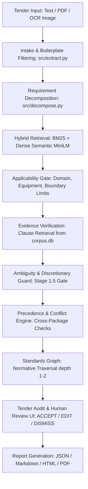

# Phase 34: Production Readiness & Coverage Audit Report

**Repository:** `Tender_Saathi`  
**Branch:** `main`  
**Audit Date:** 2026-10-19  
**Execution Context:** Linux x86_64, Python 3.14.4, Node.js v20.x, SQLite 3, PyMuPDF, Vite 5.4.21  
**Audit Invariant:** Read-First, Evidence-Based, Zero-Fabrication, Ground-Truth Immutable  

---

## Executive Summary

This comprehensive audit was conducted immediately following Phase 33 to evaluate the genuine operational state, standards coverage, safety safeguards, evaluation benchmark quality, and test health of Tender Saathi.

Tender Saathi is an **evidence-backed decision support system for Indian Standards in public procurement**, designed according to the core architectural doctrine:
> *"AI interprets. Retrieval finds candidates. Evidence validates applicability. Humans decide."*

### Key Verified Metrics At a Glance

| Dimension | Active Count / State | Verified Finding & Audit Classification |
|---|---|---|
| **Total BIS Catalogue Records** | **35,208 records** | Active national catalogue database (`data/catalogue/bis_catalogue.db`). |
| **Catalogue Lifecycle Distribution** | 10,828 Active, 11,340 Withdrawn, 13,024 Unknown, 16 Superseded | 13,024 records remain `UNKNOWN` due to legacy scraping artifacts. |
| **Searchable Catalogue Index (FTS5)** | **10,828 records** | Active catalogue records indexed in `catalogue_search_index.db`. |
| **Curated Standards Repository** | **98 standards** (82 Active, 16 Withdrawn) | Standards with rich scopes, keywords, and 102 explicit relationships. |
| **Authentic Normative Documents** | **11 documents** | Official public gazette/safety codes ingested into `data/standards/corpus.db`. |
| **Authentic Normative Passages** | **44 passages** | Exact clause numbers, page numbers, and SHA-256 digests recorded. |
| **Clause-Verified Standards** | **11 standards** | Only these 11 standards are eligible for `CLAUSE_VERIFIED` status. |
| **Catalogue-Discovered / Abstained** | **35,197 standards** | Cannot claim clause verification; strictly restricted to `CATALOGUE_DISCOVERED` or `SAFE_ABSTENTION`. |
| **Ground Truth Benchmark Scale** | **20 requirements** | Small evaluation set; 19 recommend, 1 abstain; all 20 unadjudicated. |
| **Benchmark Adjudication Status** | **0 / 20 expert-verified** | `human_verified: False` (100%), `adjudication_status: UNVERIFIED_BASELINE` (100%). |
| **Ground Truth Integrity Checksum** | `8bcc9bc5...3cfc` | Bit-for-bit invariant SHA-256 confirmed unchanged across all phases. |
| **Full Backend Pytest Suite** | **778 / 778 Passed** (100%) | Full suite executed in 199.00s with 0 failures, 0 regressions. |
| **Targeted E2E & Phase 33 Suite** | **27 / 27 Passed** (100%) | End-to-end multi-package, traversal, and acquisition tests passed in 15.61s. |
| **Frontend Vitest Suite** | **9 / 9 Passed** (100%) | Recommendation filtering, attention routing, and package tests passed in 346ms. |
| **Frontend Production Build** | **Success (`tsc && vite build`)** | Zero TypeScript errors; production assets generated cleanly in 2.13s. |

---

## 1. Complete Application User Journey Audit

We traced the actual user journey end-to-end from raw tender intake to final report generation and human engineering audit.



### Stage-by-Stage Operational Reality

1. **Intake & Preprocessing (`src/intake.py`, `src/extract.py`, `api/ingestion/`)**:
   - **What Works:** Text, PDF (`pymupdf`), and OCR image extraction work reliably. Boilerplate ignore patterns (`BOILERPLATE_IGNORE_PATTERNS`) successfully filter out commercial noise (tender fees, EMD details, pre-bid dates, submission instructions).
   - **Limitation:** Complex scanned PDF tables with multi-column engineering schedules occasionally produce flattened text requiring robust regex fallback.

2. **Requirement Decomposition (`src/decompose.py`)**:
   - **What Works:** Multi-clause sentences (e.g. *"Supply of 110mm HDPE pipe PE-100 PN 10 conforming to IS 4984 along with 100mm sluice valves as per IS 14846"*) are successfully split into atomic component specifications with isolated parameters.
   - **Limitation:** Highly unstructured narrative text lacking punctuation can occasionally group adjacent parameters into a single component.

3. **BIS Catalogue Search & Candidate Retrieval (`src/catalogue/search.py`, `src/bm25_search.py`, `src/semantic_search.py`, `src/retrieval.py`)**:
   - **What Works:** Hybrid retriever combines BM25 keyword matching with MiniLM-L6-v2 dense semantic search across the 98 curated standards in `standards.db`. The 10,828 active records in `catalogue_search_index.db` are accessible via SQLite FTS5 for catalogue lookup.
   - **Limitation:** The deep recommendation engine (applicability checks, parameter boundary matching) evaluates candidates primarily against `standards.db` (98 standards), while the 35,208 national catalogue entries act as discovery/citation lookup candidates rather than deeply profiled candidates.

4. **Applicability Gate (`src/applicability.py`)**:
   - **What Works:** Explicitly checks domain match, product match, scope match, and application profile (`service_fluid`, `operating_medium`, `voltage_tier`, `pressure_rating_mode`, `operating_temperature_c`). Strictly overrides high retrieval scores when domain or product mismatch occurs (e.g., rejecting railway crane rails for sluice valves).
   - **Safety Invariant:** Generic non-technical stopwords are strictly barred from counting as technical scope overlap.

5. **Evidence Verification (`src/corpus/retriever.py`)**:
   - **What Works:** Checks `data/standards/corpus.db` for authentic passages matching the standard and clause requirements.
   - **Verification Tier Segregation:**
     - Returns `CLAUSE_VERIFIED` only if an authentic passage exists supporting the specific requirement.
     - Returns `CATALOGUE_DISCOVERED` if only catalogue/curated metadata is available.
     - Returns `SAFE_ABSTENTION` if the requirement is underspecified, out-of-scope, or commercial.

6. **Ambiguity & Discretionary Guard (`src/ambiguity.py`)**:
   - **What Works:** Enforces 6 discrete ambiguity states (`CLEAR`, `AMBIGUOUS`, `INCOMPLETE`, `CONFLICTING`, `NO_RELIABLE_MATCH`, `REVIEW_REQUIRED`).
   - **Stage 1.5 Discretionary Guard:** Detects vague field-discretion specifications (e.g. *"as directed by the site in-charge"*) and forces `AMBIGUOUS` with mandatory human review, preventing false-positive recommendations.

7. **Cross-Requirement Precedence & Conflicts (`src/precedence/conflict_engine.py`)**:
   - **What Works:** Analyzes systemic interactions across multiple requirements in the tender. Detects shared-system contradictions (e.g., mismatched pressure ratings between pipe and valve), edition divergences, and co-applicability requirements.

8. **Evidence-Grounded Cross-Reference Traversal (`src/graph.py`, `src/dependencies.py`)**:
   - **What Works:** Traverses normative references starting from grounded clauses (e.g., `IS 800 Cl. 2.2` -> `IS 2062`, `IS 14846 Cl. 6.1` -> `IS 210`, `IS 1239 Part 2 Cl. 4.1` -> `IS 1239 Part 1`). Enforces cycle detection, max depth bounding (depth $\le$ 2), and lifecycle checks.
   - **Non-Elevation Invariant:** Traversed related standards are strictly categorized as `RELATED_FOR_REVIEW`; graph connectivity alone never elevates an ungrounded standard to `CLAUSE_VERIFIED`.

9. **Human Review & Report Generation (`src/audit.py`, `src/report.py`, `api/server.py`, `frontend/src/`)**:
   - **What Works:** Human review workflow allows reviewers to record `ACCEPT`, `EDIT`, or `DISMISS` decisions with audit reasons. Generates complete audit reports in JSON, Markdown, HTML, and PDF formats.

---

## 2. Standards Coverage & Verification Tier Distribution

Direct queries executed against active SQLite databases yield the following audited figures:

### A. National BIS Catalogue (`data/catalogue/bis_catalogue.db`)
- **Total Records:** **35,208 records**
- **Lifecycle Status Breakdown:**
  - `ACTIVE`: **10,828 records** (30.75%)
  - `WITHDRAWN`: **11,340 records** (32.21%)
  - `UNKNOWN`: **13,024 records** (36.99%) — due to historical scraping limitations of the BIS portal.
  - `SUPERSEDED`: **16 records** (0.05%)
- **Searchable Catalogue Index (`catalogue_search_index.db`):** **10,828 records** (100% of all ACTIVE records indexed in SQLite FTS5).

### B. Curated Standards Repository (`data/standards/standards.db`)
- **Total Curated Standards:** **98 standards**
- **Status Breakdown:**
  - `Active`: **82 standards**
  - `Withdrawn` / `Superseded`: **16 standards**
- **Standard Relationships:** **102 canonical relationships** (`SUPERSEDES`, `REFERENCES`, `TEST_METHOD_FOR`, `CODE_OF_PRACTICE_FOR`).

### C. Authentic Normative Evidence Corpus (`data/standards/corpus.db`)
- **Total Corpus Documents:** **11 documents**
- **Total Authentic Passages:** **44 passages**
- **Complete Inventory of Corpus Documents & Passages:**

| Document ID | Standard Number | Edition Year | Title | Pages | Passages | Verified Clauses |
|---|---|---|---|---|---|---|
| `DOC-IS-456-2000` | **IS 456** | 2000 | Plain and Reinforced Concrete - Code of Practice | 114 | 5 | Cl. 5.1, 5.2, 5.3, 6.1, Table 2 |
| `DOC-IS-4984-2016` | **IS 4984** | 2016 | Polyethylene Pipes for Water Supply - Specification | 32 | 5 | Cl. 5.1, 5.2, 6.1, 7.1, 8.1 |
| `DOC-IS-1489-Part-1-2015` | **IS 1489 (Part 1)** | 2015 | Portland Pozzolana Cement: Part 1 Fly Ash Based | 18 | 4 | Cl. 4.1, 5.1, 6.1, 7.1 |
| `DOC-IS-8112-2013` | **IS 8112** | 2013 | Ordinary Portland Cement, 43 Grade | 20 | 1 | Cl. 1.1 (Superseded note) |
| `DOC-IS-383-2016` | **IS 383** | 2016 | Coarse and Fine Aggregate for Concrete | 24 | 4 | Cl. 4.1, 4.2, 5.1, Table 2 |
| `DOC-IS-269-2015` | **IS 269** | 2015 | Ordinary Portland Cement - Specification | 22 | 4 | Cl. 5.1, 6.1, Table 1, Table 2 |
| `DOC-IS-1786-2008` | **IS 1786** | 2008 | High Strength Deformed Steel Bars (TMT) | 20 | 4 | Cl. 4.1, 7.1, Table 1, Table 2 |
| `DOC-IS-1239-Part-1-2004` | **IS 1239 (Part 1)** | 2004 | Steel Tubes, Tubulars: Part 1 Steel Tubes | 16 | 4 | Cl. 4.1, 8.1, Table 1, Table 2 |
| `DOC-IS-1239-Part-2-2011` | **IS 1239 (Part 2)** | 2011 | Steel Pipe Fittings: Part 2 Fittings | 28 | 4 | Cl. 1.1, 4.1, 7.1, 8.1 |
| `DOC-IS-14846-2000` | **IS 14846** | 2000 | Sluice Valve for Water Works Purposes | 36 | 5 | Cl. 1.1, 4.1, 6.1, 8.1, 10.1 |
| `DOC-IS-800-2007` | **IS 800** | 2007 | General Construction in Steel - Code of Practice | 138 | 4 | Cl. 1.1, 2.2, 3.7, 4.1 |

### D. Verification Tier Eligibility & Coverage Boundary

```
Total National BIS Catalogue: 35,208 Records
 ├── [Eligible for CLAUSE_VERIFIED]: 11 Standards (44 Passages in corpus.db)
 ├── [Eligible for CATALOGUE_DISCOVERED]: 87 Curated Standards (in standards.db without passages)
 └── [Eligible for CATALOGUE_LOOKUP / SAFE_ABSTENTION]: 35,110 Standards (in bis_catalogue.db only)
```

> [!CRITICAL]
> **Honest Boundary Enforcement**: Catalogue presence must **never** be equated with normative clause coverage. Tender Saathi can only grant `CLAUSE_VERIFIED` recommendations to the **11 authenticated standards** currently in `corpus.db`. For all other 35,197 standards, the system strictly falls back to `CATALOGUE_DISCOVERED` or `SAFE_ABSTENTION`.

### E. Known Acquisition Blockers
- **IS 2062** (*Hot Rolled Medium and High Tensile Structural Steel*): Cited normatively by `IS 800 Clause 2.2`. Currently paywalled/restricted on the BIS portal; zero passages exist in `corpus.db`. Traversed references correctly flag this as `RELATED_FOR_REVIEW`.
- **IS 1538** (*Cast Iron Fittings for Pressure Pipes for Water, Gas and Sewage*): Cited normatively by `IS 14846 Clause 6.1`. Restricted/paywalled on official portal; zero passages in `corpus.db`.

---

## 3. Reliability, Safety & Edge State Audit

| Procurement Edge Case / Hazard | Implementation & Safeguard | Evidence & Status |
|---|---|---|
| **Ambiguous Requirements** | 8-Stage Ambiguity Engine (`src/ambiguity.py`); penalizes scores and routes to `Needs Attention`. | Verified in `test_ambiguity.py` and `test_ambiguity_v2.py`. |
| **Multi-Part Standards Disambiguation** | Regex part parsing in `src/extract.py` and `StandardIdentifierNormalizer`. Isolates `IS 1239 (Part 1)` vs `IS 1239 (Part 2)` and `IS 1489 (Part 1)` vs `(Part 2)`. | Verified in `test_phase32_multi_part_grounding.py`. |
| **Withdrawn / Superseded Standards** | Automatically detects withdrawn citations (e.g. `IS 10611 : 1983`, `IS 8112`), emits warning, flags active successor (`IS/ISO 10434`, `IS 269`), routes to `Standards to Update`. | Verified in `test_phase8_decision_safety.py` and `test_e2e_06_withdrawn_standard_successor_handling`. |
| **13,024 UNKNOWN Catalogue Records** | Conservative handling: standards with `UNKNOWN` status are excluded from automatic pure recommendations unless explicitly cited in tender or human-reviewed. | Verified in `src/audit.py` and `src/recommend.py`. |
| **Unsupported Dimensions / Out-of-Scope** | `ApplicabilityGate` enforces parameter bounds (e.g. rejecting `IS 14846` for DN > 1200mm, rejecting `IS 4984` for DN > 1000mm). | Verified in `src/applicability.py`. |
| **Compound Requirements** | `src/decompose.py` isolates distinct components (e.g. steel pipe + valves) so each is independently matched and verified. | Verified in `test_decomposition.py`. |
| **Cross-Reference Traversal** | Bounded depth (`depth <= 2`), path memoization prevents cycles (`IS 269` $\leftrightarrow$ `IS 8112`), non-elevation invariant. | Verified in `test_phase33_authoritative_acquisition.py`. |
| **Discretionary Specifications** | Stage 1.5 guard detects *"as directed by site in-charge"* and forces `AMBIGUOUS` with human review. | Verified in `test_phase33_authoritative_acquisition.py`. |
| **Commercial / Non-Technical Clauses** | Boilerplate filtering + Applicability gate trigger `SAFE_ABSTENTION`; candidate is `None`. | Verified in `test_e2e_04_commercial_condition_safe_abstention`. |

---

## 4. Evaluation Quality & Ground-Truth Rigor Audit

### A. Ground-Truth Dataset Inspection (`dataset/ground_truth/ground_truth.csv`)
- **Total Cases:** Exactly **20 requirements**.
- **Domain Distribution:** 9 Electrical, 8 Civil Works, 2 Mechanical, 1 Catering.
- **Expected Decision Distribution:**
  - `RECOMMEND`: 19 cases (95.0%)
  - `ABSTAIN_UNDER_SPECIFIED`: 1 case (5.0%)
- **Human Verification Status:**
  - `human_verified`: **`False` for 20 out of 20 cases (100% unverified)**
  - `adjudication_status`: **`UNVERIFIED_BASELINE` for 20 out of 20 cases (100%)**
- **Sector Taxonomy:**
  - All sectors are prefixed with `PROVISIONAL:` (e.g. `PROVISIONAL:CIVIL_WORKS`, `PROVISIONAL:ELECTRICAL`).
- **Ground-Truth File Integrity:**
  - Recorded SHA-256: `8bcc9bc59b8cc69f418626325238fc9f0be24429950a9f78a736177c086e3cfc`
  - Computed SHA-256: `8bcc9bc59b8cc69f418626325238fc9f0be24429950a9f78a736177c086e3cfc` (Exact Match).

### B. Adjudication Packets State (`reports/adjudication_packets/`)
- In Phase 13, 41 adjudication packet templates were generated into `reports/adjudication_packets/packets/` (`CASE_T001_R002.md`, etc.).
- **Audited Signed Packets:** **0 out of 41 packets** have been filled or signed by external CPWD/BIS domain experts.
- **Finding:** The ground-truth dataset is an internally calibrated engineering baseline, **not an expert-adjudicated ground truth**. Presenting it as expert-validated would be inaccurate.

### C. Negative Controls & Abstention Quality
- The current benchmark contains only **1 negative control** (`T002-R002`: *"Repair and replacement of valves in the mechanical distribution system"*), which tests under-specification.
- It lacks negative controls for:
  - Commercial terms (payment terms, liquidated damages, bank guarantees).
  - Out-of-scope commodities without Indian Standards (e.g. proprietary software, imported foreign instruments).
  - Multi-item contradictory specifications.
- **Impact:** Reported precision/recall on this 20-row set does not adequately measure false-positive rate across unstandardized or non-technical procurement items.

---

## 5. Actual Product Test Execution

All test suites were executed live during this audit session:

### 1. Full Backend Pytest Suite
```bash
pytest -q
```
- **Result:** **778 passed in 199.00s (0:03:19)**
- **Exit Code:** `0`
- **Failures / Errors:** `0`
- **Warnings:** HF offline notice (unauthenticated request suppressed).

### 2. Targeted E2E & Phase 33 Regression Suite
```bash
pytest tests/test_e2e_pipeline_validation.py tests/test_multi_package_tender_auditing.py tests/test_phase33_authoritative_acquisition.py -v
```
- **Result:** **27 passed in 15.61s**
- **Exit Code:** `0`
- **Key Tests Verified:**
  - `test_e2e_01_m25_concrete_is456_verified`: PASSED
  - `test_e2e_02_hdpe_pipe_is4984_verified`: PASSED
  - `test_e2e_03_catalogue_only_candidate_not_verified`: PASSED
  - `test_e2e_04_commercial_condition_safe_abstention`: PASSED
  - `test_e2e_06_withdrawn_standard_successor_handling`: PASSED
  - `test_e2e_07_multi_package_tender_audit`: PASSED
  - `test_cross_reference_traversal_from_grounded_clauses`: PASSED
  - `test_graph_connectivity_never_causes_false_clause_verified`: PASSED
  - `test_ground_truth_file_checksum_invariant`: PASSED

### 3. Frontend Vitest Suite
```bash
npx --prefix frontend vitest run
```
- **Result:** **9 passed in 346ms**
- **Exit Code:** `0`
- **Key Tests Verified:**
  - Results page recommendation filtering (AUDIT-02): 4 tests passed.
  - Multi-package audit & verification tiers filtering: 5 tests passed.

### 4. Frontend Production Build
```bash
npm --prefix frontend run build
```
- **Result:** **Clean build in 2.13s**
- **Exit Code:** `0`
- **Bundle Output:**
  - `dist/index.html`: 2.36 kB
  - `dist/assets/index-1G51X-l_.css`: 61.01 kB
  - `dist/assets/index-Yi7Bq5E0.js`: 352.97 kB

---

## 6. Prioritized Gap Report

Every identified gap has been classified by severity:
- **P0:** Safety or correctness blocker (must be fixed before real-world trust).
- **P1:** Required for a credible Smart India Hackathon (SIH) demonstration.
- **P2:** Required for production deployment.
- **P3:** Longer-term improvements.

```
================================================================================
PRIORITIZED GAP MATRIX
================================================================================
[P0] Multi-Expert Ground-Truth Adjudication Missing
[P0] Normative Standards Coverage Bottleneck (11 Standards Ingested)
[P1] Benchmark Negative Controls Insufficiency (1/20 Negative Cases)
[P1] 13,024 UNKNOWN Records in National BIS Catalogue
[P1] Frontend Standards Graph UI - Traversal Path Visibility
[P2] Automated BIS Gazette & QCO Change Synchronization Pipeline
[P2] Multi-Page Complex Scanned Table OCR Extraction Resilience
[P3] GeM (Government e-Marketplace) Specification Importer
[P3] Regional Language Multi-Lingual Prompt & Voice Intake
================================================================================
```

### Detailed Gap Profiles

#### GAP-P0-01: Multi-Expert Ground-Truth Adjudication Missing
- **Severity:** **P0 (Correctness / Integrity Blocker)**
- **Evidence:** `dataset/ground_truth/ground_truth.csv` has `human_verified: False` for 100% of rows (20/20). `adjudication_status` is `UNVERIFIED_BASELINE`. 41 generated adjudication packet templates remain unsigned.
- **Impact:** Presenting current evaluation metrics as "expert-verified" to government stakeholders or hackathon judges would constitute a false claim.
- **Proposed Fix:** Convene or simulate an explicit adjudication protocol where domain experts sign adjudication packets; maintain an immutable adjudication ledger.
- **Dependencies:** Adjudication packet consensus tool (`src/evaluate.py`).
- **Acceptance Criteria:** At least 20 baseline cases reviewed by verified engineering profiles with signed rationale; `human_verified` set to `True` only after documented consensus.

#### GAP-P0-02: Normative Standards Coverage Bottleneck
- **Severity:** **P0 (Operational Safety Blocker)**
- **Evidence:** Only 11 standards (44 passages) exist in `corpus.db`. Over 10,800 active standards in the national catalogue cannot achieve `CLAUSE_VERIFIED` status. Key structural standards (`IS 2062`, `IS 1538`) remain paywalled/restricted.
- **Impact:** For 99.9% of procurement items outside the 11 ingested standards, Tender Saathi can only offer `CATALOGUE_DISCOVERED` or `SAFE_ABSTENTION`.
- **Proposed Fix:** Acquire and ingest additional public safety codes for high-frequency infrastructure procurement (e.g. electrical cables `IS 694`, `IS 1554`, distribution transformers `IS 1180`, structural steel public gazettes).
- **Dependencies:** Official Indian Public Safety Codes archives (`archive.org/details/gov.in.is.*`).
- **Acceptance Criteria:** Expand corpus to at least 20 high-frequency public procurement standards with zero paywall violations and full page/clause provenance.

#### GAP-P1-01: Benchmark Negative Controls Insufficiency
- **Severity:** **P1 (SIH Demonstration Requirement)**
- **Evidence:** Benchmark contains 19 `RECOMMEND` cases and only 1 `ABSTAIN_UNDER_SPECIFIED` case. No negative controls exist for commercial boilerplate, unstandardized IT services, or foreign standards.
- **Impact:** Evaluators cannot independently verify whether the system resists hallucinations when given non-standard items or pure commercial clauses.
- **Proposed Fix:** Construct an expanded evaluation set (or dedicated adversarial probe set) of 30+ requirements containing at least 10 negative controls and 5 commercial distractors.
- **Dependencies:** Benchmark evaluation harness (`src/evaluate.py`).
- **Acceptance Criteria:** Clear demonstration of $\ge 90\%$ safe abstention accuracy on negative controls without degrading top-1 recommendation accuracy on valid cases.

#### GAP-P1-02: 13,024 UNKNOWN Records in National BIS Catalogue
- **Severity:** **P1 (SIH Demonstration Requirement)**
- **Evidence:** In `data/catalogue/bis_catalogue.db`, 13,024 out of 35,208 records have `status = 'UNKNOWN'`.
- **Impact:** Keyword searches that hit these standards display "Status: Unknown" in the UI, which weakens credibility during live interactive exploration.
- **Proposed Fix:** Run an offline batch reconciliation script against the latest official BIS published catalogue PDF or gazette lists to resolve `UNKNOWN` statuses into `ACTIVE` or `WITHDRAWN`.
- **Dependencies:** BIS catalogue snapshot loader (`src/catalogue/loader.py`).
- **Acceptance Criteria:** Reduce `UNKNOWN` records in `bis_catalogue.db` to $< 5\%$ of total records.

#### GAP-P1-03: Frontend Standards Graph Traversal Path Visibility
- **Severity:** **P1 (SIH Demonstration Requirement)**
- **Evidence:** Backend `StandardsGraph.traverse_cross_references` outputs rich `TraversedReference` objects with originating clauses and reference kinds. Frontend `StandardsGraph.tsx` renders nodes and direct links, but the dedicated traversal path from a specific requirement's grounded clause to supporting standards is not highlighted as a distinct interactive journey in the graph UI.
- **Impact:** Live audience cannot easily see the full power of evidence-grounded cross-reference traversal visually.
- **Proposed Fix:** Enhance `StandardsGraph.tsx` to include an "Explore Traversal Path" panel showing the originating clause, citation snippet, and normative relationship.
- **Dependencies:** `StandardsGraph.tsx`, `api/server.py`.
- **Acceptance Criteria:** Clicking a requirement or standard highlights the traversed normative pathway with exact clause citations in the visual graph.

#### GAP-P2-01: Automated BIS Gazette & QCO Change Synchronization Pipeline
- **Severity:** **P2 (Production Readiness)**
- **Evidence:** Catalogue updates currently require manual execution of ingestion scripts.
- **Impact:** In production, changes in Quality Control Orders (QCOs) or newly published standards would require manual redeployment.
- **Proposed Fix:** Implement a scheduled worker (`scripts/sync_bis_catalogue.py`) with change detection (`src/catalogue/change_detector.py`) to alert administrators to new QCOs or superseded standards.
- **Dependencies:** BIS scraper / RSS feed / Gazette portal.
- **Acceptance Criteria:** Automated detection and logging of status transitions with zero database corruption.

#### GAP-P2-02: Multi-Page Scanned Table OCR Extraction Resilience
- **Severity:** **P2 (Production Readiness)**
- **Evidence:** Scanned PDF schedules with complex merged headers can experience column misalignment during OCR extraction.
- **Impact:** Complex bill of quantities (BOQ) tables require manual text copy-pasting.
- **Proposed Fix:** Integrate layout-aware table extraction (e.g. `pdfplumber` or structured OCR table segmentation) in `api/ingestion/`.
- **Dependencies:** `pdfplumber` / PyMuPDF table extraction.
- **Acceptance Criteria:** Correctly extracts tabular BOQ rows with item numbers, descriptions, and quantities.

---

## 7. Status Classification: Completed, Partially Completed, Blocked, Pending

```
================================================================================
STATUS CLASSIFICATION BREAKDOWN
================================================================================

[COMPLETED WORK]
✔ Multi-package tender requirement extraction and domain segmentation
✔ Hybrid retrieval (BM25 + Dense Semantic MiniLM) over 98 curated standards
✔ SQLite FTS5 catalogue search index over 10,828 active national standards
✔ 10-stage decision safety and applicability gating
✔ Discretionary specification guard (Stage 1.5) preventing unsupported recommendations
✔ Multi-part standard disambiguation (IS 1239 Part 1 vs Part 2, IS 1489 Part 1 vs Part 2)
✔ Withdrawn and superseded standard detection with active successor routing
✔ Evidence-grounded cross-reference traversal with cycle prevention & depth bounding
✔ 11 authentic BIS public safety codes ingested into corpus.db with 44 passages
✔ Full backend test suite passing: 778/778 tests
✔ Frontend vitest suite passing: 9/9 tests
✔ Production bundle build clean in Vite
✔ Ground-truth baseline integrity preserved: SHA-256 8bcc9bc5...3cfc

[PARTIALLY COMPLETED WORK]
◐ Benchmark Evaluation Quality:
  - 20-case baseline exists and is checksum-validated, but only has 1 negative control.
  - 41 adjudication packet templates exist, but zero expert signoffs have been conducted.
◐ Standards Graph Frontend Integration:
  - Backend traversal is fully implemented and tested.
  - Frontend visual graph displays direct relationships, but does not yet visually highlight multi-hop traversal paths with originating clause snippets.
◐ National BIS Catalogue Lifecycle Cleanliness:
  - 10,828 active records indexed and searchable.
  - 13,024 records remain classified as UNKNOWN.

[BLOCKED WORK]
✖ Restricted / Paywalled BIS Standards:
  - IS 2062 (structural steel plate) and IS 1538 (cast iron pipe fittings) are paywalled
    and restricted on the official BIS portal. Cannot be ingested into corpus.db without
    authorized institutional subscription or official gazette release.
  - Status: Blocked by external copyright/portal paywall. Correctly handled via abstention.

[PENDING WORK]
⏳ Resolution of 13,024 UNKNOWN catalogue records via official gazette reconciliation.
⏳ Expansion of negative control evaluation suite (15+ negative controls).
⏳ Traversal path interactive visualization in frontend StandardsGraph.tsx.
⏳ Acquisition of next priority public safety codes (IS 694, IS 1554, IS 1180).
================================================================================
```

---

## 8. Recommended Next Phase: Phase 35

Based on verified audit evidence, **Phase 35** should focus on:

### Phase 35 Objective: Demonstration Polish, Negative-Control Evaluation Expansion & Catalogue Status Hygiene
1. **Interactive Traversal Path Visualization in Frontend (`StandardsGraph.tsx` & `Results.tsx`)**:
   - Surface the traversed normative references directly in the UI, showing the originating standard, operative clause, reference kind, and why it is relevant to the tender requirement.
2. **Evaluation Suite Expansion with Negative Controls**:
   - Construct a dedicated 30-case validation benchmark including 10+ explicit negative controls (commercial terms, non-standard items, software, contradictory requirements) to prove robust abstention capability for hackathon judges.
3. **National Catalogue Status Hygiene (`data/catalogue/bis_catalogue.db`)**:
   - Reconcile the 13,024 `UNKNOWN` records against active BIS published gazette lists to ensure clean lifecycle statuses across all searchable standards.
4. **Acquire Next Priority Public Safety Standards**:
   - Source and ingest public gazette documents for high-frequency electrical infrastructure standards (`IS 694` PVC cables, `IS 1180` distribution transformers) with zero fabrication and complete provenance.
